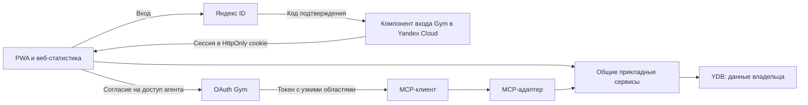

# Вход, сессии и доступ тренировочного агента — P02.2

Обновлено: 2026-10-26. **Проект P02.2 принят пользователем командой «Завершаем этап» после проверки результата.** Выбраны Яндекс ID, допуск только приглашённых, параметры сессий/MCP и потоки ниже; [ADR-0014](adr/0014-user-sessions-and-agent-authorization.md) имеет статус «Принят». Реализация и реальные интеграционные проверки выполняются на следующих этапах.

Основа — личные аккаунты/серверные права из ADR-0004, общий прикладной слой REST/MCP из ADR-0001 и один HTTPS origin PWA/API из ADR-0013. В [локальном клиенте](../web/README.md) входа нет; `local-demo` не является настоящим аккаунтом. В этом этапе проектируем контракты, не подключаем рабочие аккаунты и не выдаём облачные права.

## Три независимых доступа

| Поток | Чью личность подтверждает | Что даёт |
| --- | --- | --- |
| GitHub OIDC → Yandex IAM | Задание сборки/выпуска | Облачные права CI, без входа в личный аккаунт Gym |
| Яндекс ID → сессия Gym | Человека, вошедшего в приложение | Доступ PWA/веб-статистики к его данным |
| OAuth Gym → MCP | Делегирование конкретному клиенту от пользователя Gym | Ограниченные области чтения/записи в его аккаунте |

Токен Яндекс ID не передаётся агенту и не принимается как токен Gym API/MCP. Облачные IAM-токены не принимаются как пользовательский вход. Согласие на подключение агента не заменяет одобрение изменения программы.

## 1. Поставщик и допуск

**Подтверждено пользователем 2026-10-26:** вход через Яндекс ID; только приглашённые — владелец и друзья, без открытой регистрации. Ниже сохранено сравнение рассмотренных альтернатив; email, Telegram и MAX в начальный объём входа не включены.

| Вариант | Как входит пользователь | Что потребуется Gym |
| --- | --- | --- |
| Email, одноразовый код или ссылка | Подтверждает доступ к приглашённому ящику, отдельный пароль Gym не нужен | Доставка писем, срок/одноразовость кода и защита от перебора/повторных отправок. Для PWA код позволяет остаться на прежней странице; удобство проверить на устройстве |
| Email и пароль | Создаёт собственный пароль Gym | Хеширование, подтверждение почты и восстановление пароля; больше собственной логики аккаунтов |
| Яндекс ID | Подтверждает вход у внешнего поставщика | Регистрация приложения и серверный code/PKCE-поток ниже |
| Telegram | Подтверждает аккаунт Telegram | Бот/регистрация URLs, OIDC code + PKCE и проверка ID token по [официальной документации](https://core.telegram.org/bots/telegram-login) |
| MAX | Подтверждённый документацией путь — запуск мини-приложения внутри бота с проверкой подписанных стартовых данных | Партнёрский доступ/бот и дополнительная связка с самостоятельной PWA. Универсальный публичный OAuth/OIDC-вход для внешнего сайта по изученным страницам не подтверждён |

Для отправки кодов по email можно рассмотреть Yandex Cloud Postbox: его [настройка](https://yandex.cloud/ru/docs/postbox/quickstart) требует подтверждённого домена отправителя. Домен пользователя пока не выбран; другие варианты SMTP/доставки также требуют настройки. Почтовая инфраструктура не создана.

В [документации MAX](https://dev.max.ru/docs/webapps/introduction) мини-приложения работают внутри ботов, а подключение партнёрской платформы доступно юрлицам, ИП и самозанятым — резидентам РФ. [Проверка стартовых данных](https://dev.max.ru/docs/webapps/validation) подтверждает личность внутри этого сценария. Это основание считать MAX отдельной интеграцией для исследования, а не обещать готовую замену веб-входа. Право пользователя на подключение платформы не проверено.

Для первой версии выбран один способ — Яндекс ID. Поддержка нескольких способов и привязка дополнительных идентичностей потребуют отдельного решения. Раздел 2 описывает принятый поток выбранного провайдера.

Для Яндекс ID регистрируем отдельное приложение **для авторизации пользователей** каждого окружения с точным callback URL. Это другой тип приложения, чем технический доступ к API. Яндекс документирует поток authorization code с `state` и PKCE `S256`; сведения о личности получаем сервером из `https://login.yandex.ru/info?format=json`. Источники: [регистрация](https://www.yandex.ru/dev/id/doc/ru/register-client), [поток кода и PKCE](https://www.yandex.ru/dev/id/doc/ru/codes/code-url), [информация о пользователе](https://yandex.ru/dev/id/doc/ru/user-information).

Запрашиваем только выбранные при регистрации права входа (`login:info`), без почты, телефона, аватара и доступа к другим сервисам. Ответ провайдера может содержать больше полей, чем нужно Gym: сохраняй только необходимые. Набор реально выдаваемых разрешений нужно проверить при регистрации, не расширять его молча при ошибке.

Внутренний `user_id` Gym — собственный непрозрачный ID. Отдельная уникальная привязка `(provider, provider_subject)` использует проверенный `id` Яндекс ID; ответ `client_id` должен совпасть с ожидаемым приложением окружения. Логин, имя, email, имя организации YC и GitHub login не являются ключом пользователя и не разрешают автоматическое объединение аккаунтов. Дополнительные провайдеры/перепривязка личности не входят в первый вариант.

По запросу пользователя 2026-10-30 панель аккаунта показывает логин Яндекса из проверенного сервером ответа [userinfo](https://yandex.ru/dev/id/doc/ru/user-information). Сохраняй только эту подпись в документе успешной сессии как `yandex_login`; токен и остальной профиль провайдера не сохраняй. Подпись не участвует в допуске, поиске владельца или объединении аккаунтов. `/auth/session` возвращает необязательное nullable-поле `yandex_login`: прежние сессии без него продолжают работать, UI предлагает явно подтвердить тот же аккаунт для получения подписи. Подтверждение не меняет сроки сессий и не очищает локальные тренировки. При выборе отдельного профиля показывай подпись фактически подтверждённого аккаунта ещё до открытия его локального раздела.

Для согласованного закрытого доступа используем управляемый список допуска по подтверждённой личности. Неприглашённый пользователь после успешного входа получает отказ доступа к Gym, а не пустой аккаунт с правами. Начальную личность владельца разрешает оператор через отдельно авторизованную административную процедуру; «первый вошедший становится администратором» запрещено. Способ выдачи приглашения новым друзьям уточняется в P06; приглашение не должно основываться только на присланном клиентом логине/email без подтверждения. До успешной проверки личности никакой записи в список допуска нет.

Сервер проверяет допуск и состояние аккаунта (`active`/`disabled`) для каждого обращения. Отказ во входе не меняет и не очищает локальные тренировки. Точный способ выдачи приглашений реализуется в P06; политика закрытого допуска принята.

## 2. Вход PWA и веб-статистики

Принятый поток:

1. `GET /auth/login` создаёт короткую серверную транзакцию входа: случайные `state`, браузерную привязку и PKCE verifier. Возвращаемый путь выбирается из разрешённых относительных маршрутов; произвольный `return_to` не превращается в redirect.
2. Случайная привязка браузера находится в отдельной временной HttpOnly cookie. Транзакция хранит проверяемые значения/срок и назначение (`login`, `reauth`, `switch`); verifier остаётся на сервере. Не используй память экземпляра Cloud Function как единственное хранилище.
3. Перенаправь на фиксированный authorize endpoint провайдера с точными `client_id`, `redirect_uri`, `state`, `code_challenge` и `S256`. Origin/callback бери из конфигурации окружения, а не из произвольного Host/входного URL.
4. `GET /auth/callback/yandex` проверяет браузерную привязку, `state`, срок и одноразовость транзакции. Подмена/повтор callback отклоняется. Транзакция не должна завершаться успешно из двух параллельных запросов.
5. Сервер обменивает код на токен с verifier и настроенными клиентскими учётными данными, получает личность и проверяет допуск. При неопределённом исходе обмена начни новый вход; не повторяй использованный код без разбора состояния.
6. После успеха создай новую сессию Gym, ротируя прежний идентификатор; очисти временную cookie и перенаправь на чистый URL без кода. Токен провайдера используй только для получения личности и затем не сохраняй для работы с тренировками.

Ответ callback не загружает сторонние ресурсы. Для auth-ответов — `Cache-Control: no-store` и `Referrer-Policy: no-referrer`; код, cookie, токены, verifier и тела ответов провайдера исключены из журналов/телеметрии. Отмена согласия возвращает понятный отказ, без изменения локальных данных. Рекомендации безопасности потока — [RFC 9700](https://www.rfc-editor.org/rfc/rfc9700.html); конкретная интеграция с браузером и шлюзом ещё не проверена.

Используем cookie `__Host-gym_session`: `Secure; HttpOnly; Path=/; SameSite=Lax`, без `Domain`. Её случайное значение не читается JS и не сохраняется в IndexedDB/localStorage. Хеш идентификатора, `user_id`, времена и отзыв хранятся сервером в YDB. Условия префикса и атрибутов — [MDN Set-Cookie](https://developer.mozilla.org/en-US/docs/Web/HTTP/Reference/Headers/Set-Cookie). Это контракт для HTTPS окружений; локальный HTTP dev-режим не доказывает корректность cookie.

Для изменяющих запросов с cookie нужны проверка точного Origin и CSRF-токен, связанный с серверной сессией. `SameSite` не является единственной CSRF-защитой. `GET` не публикует программу и не изменяет результаты тренировок. Прикладные операции проверяют пользователя на сервере; `user_id` из тела не назначает владельца.

Начальные сроки **Gym**, а не гарантии провайдера:

| Объект | Начальный вариант | Поведение после истечения |
| --- | --- | --- |
| Транзакция входа | 5 минут, одна попытка завершения | Начать новый вход |
| Сессия PWA | 7 дней неактивности, максимум 30 дней | Повторный вход для серверных запросов, локальная запись остаётся |
| Проверка личности перед одобрением программы | Не старше 10 минут | Повторный интерактивный вход, затем просмотр/подтверждение |

Проверка через провайдера не означает обязательный повтор пароля или MFA: при активном SSO провайдер может подтвердить уже установленную личность. Отзыв приложения в Яндекс ID нельзя считать доказанным мгновенным отзывом ранее выданной сессии Gym; в Gym нужны собственные выход/отзыв/блокировка. Сроки проверяются серверными часами на запросе, а не только удалением строки по TTL.

## 3. Повторный вход, выход и очередь

Получай `user_id` только из ответа аутентифицированного `/auth/session`. До отправки исходящих операций сверяй его с владельцем локального раздела. Cached owner — подсказка клиенту, не доказательство личности для сервера. Реаутентификация с другим аккаунтом даёт явное несовпадение; не перемещай старые операции в новый раздел.

| Ситуация | Поведение |
| --- | --- |
| Истекла сессия, сети нет | Продолжать локальную запись в ранее установленном аккаунте; показать необходимость входа для доставки |
| Повторный вход тем же пользователем | Сохранить прежние ID операций, продолжить доставку после проверки личности |
| Вход другим пользователем | Отдельный кэш/очередь; прежний раздел сохраняется и не отправляется новым аккаунтом |
| Выход онлайн с ожидающими данными | Предложить сначала доставить их либо выйти с сохранением закрытого локального раздела; не удалять его автоматически |
| Выход онлайн | Отозвать серверную сессию, очистить cookie и закрыть локальный профиль. При сетевой ошибке не обещать серверный отзыв |
| Пользователь хочет скрыть данные без сети | Явное «Скрыть данные на устройстве», без обещания серверного выхода; новый вход/переключение без сети не доступны |
| Заблокирован аккаунт | Серверные записи запрещены; локальные результаты сохраняются, но не считаются доставленными |

Локальная блокировка интерфейса не шифрует профиль браузера. Дополнительный PIN/биометрия/шифрование не подразумеваются. Текущая тестовая очередь `local-demo` не переносится в новый аккаунт автоматически. Структура разделов, точные состояния доставки/очистки и конфликты — P02.3.

## 4. Делегирование MCP

Рабочая целевая интеграция — ChatGPT, как в прежних открытых вопросах; конкретный аккаунт/рабочее пространство пользователя ещё не проверены. По [OpenAI Docs: подключение MCP](https://developers.openai.com/api/docs/guides/custom-mcp-server) поддерживаются инструменты чтения/записи и OAuth. [OpenAI Docs: authentication](https://developers.openai.com/plugins/build/auth) описывает code + PKCE, discovery и регистрацию клиента. Доступность подключения и точные callback URI проверяются на реальном целевом аккаунте до выпуска MCP; наличие этой сессии Codex этого не доказывает.

Для Gym MCP нужен отдельный OAuth-компонент **Gym**, использующий Яндекс ID только как внешний вход человека. Он выдаёт собственный ограниченный токен, а MCP-адаптер передаёт в прикладные сервисы проверенную личность/области доступа. Предпочти проверенную OAuth-библиотеку и серверную проверку протокола; не реализуй криптографию/проверки OAuth вручную. Конкретный пакет и хранение в YDB проверяются инженерным срезом перед MCP, не объявляются готовыми здесь.

Для первого закрытого пилота используем предварительно зарегистрированный OAuth-клиент с точным списком redirect URI. Его ID/метод проверки клиента берутся из фактической настройки ChatGPT, секрет — только в защищённой настройке клиента, без передачи в чат/Git. Это одна из разрешённых [спецификацией MCP 2026-07-28](https://modelcontextprotocol.io/specification/2026-07-28/basic/authorization) схем регистрации. Открытую DCR-регистрацию не включаем. CIMD — предпочтительное развитие стандарта, но требует отдельной проверки загрузки/валидации метаданных; сейчас не рекламируем неподдерживаемую возможность.

Сервер публикует Protected Resource Metadata для `/mcp` и Authorization Server Metadata для своего issuer. Поток — authorization code + PKCE `S256`, с `resource`, привязкой code к клиенту/redirect URI и одноразовым обменом. MCP принимает Bearer только для своего канонического audience данного окружения; cookie PWA и токен Яндекс ID его не заменяют. Пропущенный/истёкший токен — `401`, недостаточная область — `403` с challenge по спецификации. Метаданные можно получить анонимно; личные данные/инструменты требуют пользователя.

Начальные Gym scopes (точные имена проверяются с контрактами P02.4):

| Область | Разрешает | Не разрешает |
| --- | --- | --- |
| `program:read` | Собственную опубликованную программу/шаблоны | Чужие программы или публикацию |
| `history:read` | Собственную историю в запрошенных границах | Произвольную выгрузку других аккаунтов |
| `stats:read` | Собственную рассчитанную статистику | Подменять серверную формулу |
| `program:draft` | Создать/проверить собственный черновик изменения | Публиковать без одобрения |
| `program:publish` | Применить конкретное уже одобренное изменение | Самостоятельно создать факт одобрения |

Начальные права минимальны для выбранных инструментов; расширение запрашивается отдельно и показывается пользователю. Редактирование/удаление тренировочных фактов агентом в первую выдачу прав не входит. Согласие хранит `user_id`, клиент, resource, разрешённые scopes, время и отзыв; ограничения прав проверяются вместе с принадлежностью каждого объекта, а не только по имени инструмента.

Для первого варианта используем случайные непрозрачные access/refresh tokens с хешами в YDB, а не вводить собственный JWT/JWKS без необходимости. Проверка каждой операции включает срок, audience, клиента, scopes, состояние grant и пользователя. Начальные сроки: access token 10 минут; refresh — 30 дней бездействия/90 дней максимум, если клиенту выдано разрешение длительного доступа. Refresh ротируется атомарно; повтор использованного refresh отзывает семейство и требует новой привязки. Потеря ответа при ротации — явный сценарий повторного входа, не повод бессрочно принимать старый refresh. Основа ротации — [RFC 9700, раздел 4.14](https://www.rfc-editor.org/rfc/rfc9700.html#section-4.14).

Отзыв «Доступа агента» прекращает этот grant и его refresh/access tokens, сохраняя историю. Выход из PWA на одном устройстве — отдельное действие; не обещай, что оно автоматически отозвало все подключения MCP. Отключение аккаунта блокирует все серверные операции. Длительный OAuth-доступ агента и отсутствие сети у PWA — разные механизмы.

## 5. Одобрение изменения программы

Обязательный путь: агент готовит/валидирует черновик → пользователь открывает страницу Gym с изменениями и основанием → явно одобряет конкретную редакцию → публикацию выполняет общий прикладной сервис. Ввод `approved: true` инструментом, инструкция в тексте чата и согласие на OAuth не создают серверного одобрения. Подтверждение действия самим ChatGPT дополняет проверку Gym, но не подменяет её.

Одобрение связывается с владельцем, ID/редакцией черновика, базовой версией программы, digest содержания и, для выполнения агентом, клиентом/grant. Срок — 10 минут, одно применение. Изменённый черновик, другая база, отозванный grant или истёкшее одобрение требуют повторной проверки/одобрения; пустая ссылка на прежнее одобрение не разрешает новый текст.

Публикация атомарно проверяет предусловия, создаёт неизменяемую новую версию и расходует одобрение; повтор операции возвращает прежний результат без второй версии. Если сервер сам публикует по кнопке PWA, последующий MCP-вызов должен увидеть уже выполненный результат. Снимки начатых/прошлых занятий остаются прежними. Идемпотентность, canonical digest и точные транзакции — P02.3/P02.4 и интеграционные тесты YDB, а не обещание реализованного кода.

## 6. Секреты и минимальные данные

| Данные | Место/политика |
| --- | --- |
| Client ID, issuer, callback/канонический MCP resource | Несекретная конфигурация окружения в Git/GitHub Variables |
| Client secret провайдера, если используется, и секреты OAuth-клиента | Защищённая конфигурация/Lockbox своего окружения; не JS/чат/репозиторий |
| Токен Яндекс ID после обмена | Только серверная обработка получения личности; не клиентское хранилище и не MCP |
| Сессия браузера | Случайный секрет в HttpOnly cookie, проверочные данные/хеш на сервере |
| Gym access/refresh tokens | У OAuth-клиента в его защищённом хранилище; сервер хранит проверочные хеши и ограничения |
| Пользовательские тренировки и очередь | Аккаунтный раздел IndexedDB; авторизованные серверные данные в YDB |

Серверные записи сессий/кодов/согласий — обычные данные, не повод выполнять DDL в HTTP-запросе. Схема создаётся отдельными миграциями. Runtime получает права только своего окружения и нужных секретов; GitHub PR не получает их или данные пользователей. Логи содержат безопасный код события/корреляцию, без кодов входа, cookies, токенов и полного ответа личности. Личная статистика будущего лендинга использует ту же сессию и серверную авторизацию.

Сессионные и auth-ответы не кэшируются в service worker. Путь `/auth/*` и метаданные/endpoint OAuth/MCP нужно явно исключить при подключении входа: нынешний service worker локального демо ещё не реализует этот контракт. Проверяй реальные `Set-Cookie`, заголовки и redirect через Gateway, а не только функцию напрямую. При недоступности проверки личности/прав сервер отказывает в личном доступе, не переключается на `local-demo`.

## 7. Приёмка при реализации

Все пункты ниже — будущие тесты, не выполненные проверки входа:

| ID | Сценарий | Ожидаемый результат |
| --- | --- | --- |
| AUTH-01 | Корректный первый вход разрешённой личности | Свой Gym user_id, новая сессия, без токенов провайдера в браузере |
| AUTH-02 | Нет допуска / аккаунт отключён | Нет прав на программы/историю и роли владельца по порядку входа |
| AUTH-03 | Подменён state/binder/redirect, истёк или повторён callback | Отказ без сессии другого пользователя; параллельный callback не расходует транзакцию дважды |
| AUTH-04 | Личность имеет другой client_id или серверу прислан чужой токен | Отказ; логин/email не подменяют проверенный subject |
| AUTH-05 | Два пользователя обращаются к одному ID занятия/черновика | Чужой объект недоступен независимо от body user_id и scopes |
| AUTH-06 | Cross-origin POST с cookie, отсутствующий/чужой CSRF | Нет изменения данных или публикации |
| AUTH-07 | Истечение входа/восстановление сети/другой аккаунт | Очередь прежнего владельца сохранена и не отправлена от другого |
| AUTH-08 | Отказ провайдера/сбой YDB/ошибка callback | Нет фиктивного входа, потери локальных результатов или секретов в логах |
| AUTH-09 | MCP-код повторён, другой verifier/client/redirect/resource | Отказ; PWA cookie и токен CI не дают MCP-доступа |
| AUTH-10 | Чужой audience, истёкший/отозванный токен, недостающий scope | Отказ с корректным challenge, без личного результата |
| AUTH-11 | Refresh использован повторно / потерян ответ | Семейство больше не даёт доступ; нужна новая привязка |
| AUTH-12 | OAuth-согласие есть, одобрения конкретного черновика нет | Публикация запрещена |
| AUTH-13 | Черновик/база/digest изменены после одобрения | Повторное одобрение; старое не расходуется на другой текст |
| AUTH-14 | Публикация повторена после потери ответа | Одна новая версия, неизменные прошлые снимки, прежний результат операции |
| AUTH-15 | Login/logout/сессии через реальный HTTPS Gateway на iPhone/Android | Cookie/return path работают в браузере и установленной PWA; auth-ответов нет в кэше |
| AUTH-16 | Реальный целевой ChatGPT-клиент подключает MCP | Discovery, выбранная регистрация, code/PKCE, разрешённое чтение/запись и отзыв работают; неподдержанный режим не объявлен успешным |
| AUTH-17 | Выход/смена аккаунта при запросе записи без подтверждённого результата | Прежняя очередь не удаляется и не отправляется новым владельцем; повтор прежним владельцем не создаёт дубль |
| AUTH-18 | Перезапуск страницы, смена сессии и повтор выхода | `/auth/session` выдаёт текущий CSRF без кэширования; старый токен не даёт запись после смены сессии; повтор выхода безопасен |

## 8. Контракт PWA для реализации

Ниже — принятый контракт P02.2. Он уточняет поток входа; форматы операций тренировок и их конфликтов остаются в P02.3/P02.4. Пути относятся к одному HTTPS origin окружения. Запросы с cookie доступны только приложению этого origin; межсайтовую выдачу личных ответов не включаем.

| Запрос | Успешный результат | Ограничения и отказ |
| --- | --- | --- |
| `GET /auth/login` | Создана транзакция, переход на Яндекс ID | Только разрешённый относительный путь возврата; ошибка не изменяет локальный профиль |
| `GET /auth/callback/yandex` | Одноразовый обмен, проверка допуска, новая cookie, переход на чистый URL | Отмена, неверная привязка, повтор или отсутствие допуска не создают сессию; подробности личности не выводятся в URL |
| `GET /auth/session` | `user_id`, время окончания сессии и связанный с ней CSRF-токен | `401`, если действующей сессии нет; `403`, если аккаунт отключён. Ни cookie, ни токены провайдера в JSON не возвращаются |
| `POST /auth/logout` | `204`: текущая серверная сессия отозвана, cookie очищена | Для действующей сессии нужны Origin и CSRF; недоступность сервера не считается успешным отзывом |

Все ответы этих маршрутов, включая ошибки и перенаправления, имеют `Cache-Control: no-store`. Ответ `/auth/session` не хранится в IndexedDB/service worker: там остаётся только локальная привязка владельца. CSRF-токен держится в памяти страницы и запрашивается заново после перезапуска; после смены сессии прежний токен недействителен.

Повторный выход после уже завершённого выхода безопасен: сервер может снова ответить `204` и очистить cookie при отсутствии действующей сессии; это не создаёт новую сессию и не отзывает чужие. Отзыв подключения MCP выполняется отдельно и в этот маршрут не входит.

У личных запросов API различаются три случая:

- `401` — действующей сессии нет: приостановить доставку, предложить вход, сохранить локальные операции.
- `403` — аккаунт или действие не разрешены: показать отказ и остановить соответствующую отправку; бесконечный повтор входа проблему не исправляет. Ошибка CSRF требует отдельно обновить `/auth/session`, а не повторять запись без защиты.
- Сетевой сбой или `5xx` — результат запроса не подтверждён: сохранить очередь и повторять согласно будущему протоколу синхронизации. Ответ не является доказательством выхода или доставки записи.

Клиент различает безопасные коды ошибок, например `session_required`, `account_disabled` и `csrf_failed`, без передачи токенов или полного ответа провайдера. `user_id` из `/auth/session` сверяется перед запуском доставки; при несовпадении синхронизация прежнего раздела не запускается. Эта сверка дополняет обязательную серверную проверку владельца каждой операции.

### Поведение на экране

| Сценарий | Что видит и делает пользователь | Что происходит с данными |
| --- | --- | --- |
| Первый запуск | «Войти через Яндекс ID»; после входа проверяется приглашение | Тестовая история не становится личной автоматически |
| Неприглашённая личность | «Доступ пока не предоставлен» и возможность повторить вход другим аккаунтом | Нет личных данных Gym или автоматического допуска |
| Сессия истекла во время тренировки | «Войди, чтобы отправить результаты»; запись подходов остаётся доступной локально | Ничего не удаляется и не помечается доставленным |
| Повторный вход совпал с владельцем | Возврат к прежней тренировке | Очередь продолжает доставку с прежними ID операций |
| Повторный вход другим аккаунтом | Предупреждение о несовпадении и выбор вернуться к входу либо открыть отдельный профиль | Прежняя очередь остаётся закрытой для нового аккаунта |
| Выход с ожидающими записями | «Сначала отправить» либо «Выйти и сохранить на устройстве» | Отмена выхода сохраняет текущую работу; выбранный выход не удаляет очередь |
| Запрошен выход без сети | «Скрыть данные на устройстве» с пояснением о незавершённом серверном выходе | Скрытый профиль не открывается автоматически при восстановлении сети |
| Агент предлагает новую программу | Ссылка на Gym с конкретными изменениями и кнопкой «Одобрить и опубликовать» | Публикуется только показанная редакция, с серверной проверкой актуальности |

Пока пользователь выбирает действие при несовпадении аккаунта, личные экраны и очередь остаются привязаны к прежнему разделу; новая cookie не разрешает отправить его операции. Отправка останавливается перед выходом/переключением; итог уже начатого запроса может быть неизвестен. Это не отменяет серверный запрос задним числом: при следующем входе прежнего владельца используется тот же ID операции, без создания дубля. Согласование вкладок, точные состояния очереди и момент переключения разделов нужно определить в P02.3.

Основной путь публикации — кнопка в Gym сразу выполняет одобренное изменение через общий сервис. Агент затем читает результат; отдельное повторное подтверждение в чате не требуется. Если позже выполнение будет делегировано MCP-инструменту, к нему применяются те же одноразовое одобрение, привязка к grant и идемпотентность из раздела 5.

### Граница следующих этапов

| Этап | Что нужно довести до рабочего состояния |
| --- | --- |
| P02.3 | Состояния профиля/очереди, координация вкладок, неизвестный результат запроса, переключение владельца |
| P02.4 | Контракты прикладных ошибок, точная редакция/digest и предусловия публикации |
| P03.2 | Серверный каркас и миграции, пригодные для последующей реализации этих контрактов |
| P06 | Реальный вход Яндекс ID, допуск владельца/друзей, сессии/выход и публикация с проверкой прав |
| P10.2 | Gym OAuth и подключение целевого MCP-клиента с проверкой регистрации, scopes и отзыва |

До приёмки P06 локальный клиент не объявляется приложением с личными аккаунтами; до приёмки P10.2 описанный OAuth не объявляется работающей интеграцией с ChatGPT. Реальные приложения/секреты создаются при подключении входа, отдельно для окружений.

## Что нужно проверить при реализации

- Проект P02.2 принят: Яндекс ID, допуск приглашённых, сроки сессий, локальный выход/повторный вход, границы MCP и одобрение. Конкретные библиотеки, схема данных, контракты синхронизации и совместимость реального клиента проверяются в назначенных этапах, а не считаются реализованными по этому решению.
- Перед реализацией входа: выбрать callback/origin каждого окружения, зарегистрировать приложения, проверить минимальный scope и реальное получение личности. Секреты в чат не присылай. Сейчас приложения OAuth/секреты не создавались.
- Перед MCP: подтвердить конкретный целевой аккаунт/режим ChatGPT, способ регистрации клиента, точные callback URI и совместимость библиотеки OAuth; проверить безопасный минимальный обмен на синтетическом стенде.
- До сервера закрыть P02.3/P02.4; роли, схема YDB, локальный кэш и форматы очереди не утверждены этим документом. Готовность проектного этапа не равна работоспособной интеграции и не разрешает открывать личные данные до приёмки.
