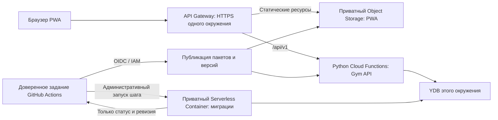

# Схема развёртывания Gym — проект P01

Обновлено: 2026-10-28. **Схема согласована, [ADR-0013](adr/0013-release-artifacts-and-migration-worker.md) принят.** Принятые ограничения — в ADR-0009–0011 и [CI/CD](ci-cd.md). По отдельному запросу пользователя первоначальная инфраструктура создана уже в P01.1; факты и команды — в [infra/README.md](../infra/README.md). Публикация и миграции main проверены; автоматическая выкатка приложения на проверке в P04.3.2.2.

Реализация 2026-10-28: [доверенная сборка/публикация](../infra/release-pipeline.md) и [миграции staging](../infra/staging-migrations.md) успешны в CI main после merge #14. [API/PWA/Gateway](../infra/staging-app.md) опубликованы оператором на пакетах этого main в режиме operator-validation; HTTPS/offline smoke и повтор успешны. Первый автоматический job deploy с новым Gateway-артефактом проверяется после отдельного merge. Production-promotion — P05.

## Исходные данные и границы

Проверены организация `organization-b-shurygin` (`bpf0t8ve1h1ckdn59bot`), облако `b1ghmudqihbvpnscd2fq` и активная оплата. Пользователь авторизовал YC CLI и разрешил до 3 000 ₽ в месяц на Gym. Созданы каталоги, пустые ресурсы, федерация и GitHub Environments; постоянные ключи в GitHub не сохранялись. Собственный домен пока не выбран.

Проект рассчитан на малое число пользователей и редкие выпуски. Первоначальная настройка выделена в P01.1 после запроса «Поехали настраивать все это». Приложение и полноценные процессы выпуска остаются в P03–P05; положительные и отрицательные проверки прав runtime выполняются вместе с ними. Поставщик входа пользователей и делегированный OAuth MCP относятся к P02, а не к OIDC-доступу GitHub в облако.

## Предлагаемая топология

Такая схема повторяется для staging и production. Приватность бакета/контейнера означает проверку IAM; это не утверждение о доступности только из частной VPC.

| Каталог | Предлагаемые ресурсы | Данные |
| --- | --- | --- |
| `gym-staging` | YDB Serverless, функция API, API Gateway, бакет PWA, контейнер миграций, сервисные аккаунты/секреты | Только синтетические программы и занятия |
| `gym-production` | Отдельный экземпляр каждого ресурса staging | Реальные данные только после готовности P11 |
| `gym-delivery` | Приватный бакет выпусков, Container Registry образов миграций, OIDC-федерация/аккаунт публикации | Код, зависимости, манифесты; без тренировок/резервных копий БД |

Ресурсы размещаются в российском регионе; региональные и зональные идентификаторы берутся из фактически доступных ресурсов. Для глобально уникальных бакетов нужен суффикс проекта, а не буквальное короткое имя из таблицы. Предварительно подготовленные экземпляры и отдельная ВМ не требуются.

## HTTPS, маршрутизация и конфигурация PWA

Для каждого окружения используем **фактически выданный служебный домен API Gateway**, а не самостоятельно составленный адрес из ID. Он поддерживает HTTPS; интеграция `object_storage` может читать приватный бакет от имени сервисного аккаунта. Это подтверждено [документацией шлюза](https://yandex.cloud/ru/docs/api-gateway/quickstart/) и [расширения Object Storage](https://yandex.cloud/ru/docs/api-gateway/concepts/extensions/object-storage).

Предлагаемые маршруты:

- `/api/v1/...` — только функция API; неизвестный маршрут API возвращает ошибку API, не HTML приложения.
- `/assets/...` — ресурсы с хешами в именах. Одинаковый URL никогда не получает другое содержимое; старые ресурсы остаются доступны.
- `/`, манифест и service worker — точки входа текущего выпуска. HTML публикуется последним, после готовности API и всех ресурсов.
- Маршруты экранов PWA могут возвращать её HTML, но отсутствующий JS/CSS не должен подменяться HTML с кодом 200.

Клиент обращается к относительному `/api/v1`; одна сборка JS подходит обоим окружениям. Если потребуется публичная конфигурация входа/выпуска, её загружаем отдельно, с собственной версией и без секретов. Cookies, CSRF и параметры авторизации уточняются после выбора входа в P02. Миграционный контейнер в этот шлюз не подключён.

Статические ресурсы получают длительный `Cache-Control`, HTML/манифест/service worker — короткое кэширование с повторной проверкой. В P04 проверяем фактические HTTP-заголовки через шлюз, MIME-типы и область действия service worker. Сбой этой проверки блокирует выпуск, а не замещается предположением о поведении Object Storage.

Если позже появится собственный домен, он задаётся конфигурацией шлюза. **Смена origin меняет хранилище браузера:** IndexedDB и ожидающая очередь старой PWA автоматически не переедут. Перед реальным пилотом определяем постоянный origin; последующий перенос требует отдельного сценария сохранения несинхронизированных данных. Имена production-ресурсов не меняем только ради каждого релиза.

## Описание и первоначальное создание инфраструктуры

Способ для MVP — версионируемые конфигурации ресурсов и OpenAPI плюс сценарии `yc`/API. Первоначальные сценарии реализованы в [infra/](../infra/README.md); управление версиями приложения добавляется в P04/P05. Конкретный cloud ID передаётся конфигурацией, секреты — через безопасную аутентификацию/Lockbox, а не исходные файлы.

Сценарий сначала читает существующее состояние и показывает план изменений. Он отличает создание от обновления, возвращает проверяемые ID/версии и останавливается при неожиданном владельце/окружении. Удаление, замена базы и выдача новых привилегий не входят в обычный релиз. Повторный запуск не создаёт новые ресурсы под теми же логическими именами. Значимые изменения конфигурации рассматриваются в PR, ручные отклонения обнаруживаются при следующей проверке.

Terraform остаётся альтернативой при росте инфраструктуры. Его провайдер поддерживает IAM-токен, но S3 backend — отдельный механизм аутентификации/state: [пример провайдера](https://yandex.cloud/ru/docs/terraform/authentication) и [пример backend](https://yandex.cloud/ru/docs/terraform/tutorials/terraform-state-storage) различаются. Не вводим скрытую зависимость от постоянного S3-ключа в GitHub ради файлов состояния.

Однократная настройка выполняется из уже авторизованной среды оператора. В GitHub нет возможности получить доверие федерации, пока её привязки ещё не созданы. После настройки повседневный деплой работает на краткоживущих OIDC/IAM-токенах; полномочия первоначального администратора не выдаются обычным заданиям релиза.

## Учётные записи и границы доступа

Это матрица необходимых возможностей. Точные роли и уровень назначения проверяются в P04 на выбранных ресурсах: название широкой роли само по себе не доказывает минимальные права.

| Учётная запись | Допустимые действия | Не выдаём |
| --- | --- | --- |
| Оператор первоначальной настройки | Создание каталогов, федерации, аккаунтов и точечных назначений | Его учётные данные не используются в workflow PR/релиза |
| Публикация артефактов | Запись нового неизменяемого release-префикса и образа в delivery | Доступ к YDB и изменение production |
| Деплой staging | Чтение выпуска, публикация версий staging и вызов его миграционного задания | Любые production-ресурсы |
| Деплой production | Чтение выбранного выпуска, публикация версий production, вызов его миграционного задания | Прямые запросы к пользовательским таблицам и выгрузка БД |
| API каждого окружения | Только нужные операции с таблицами этого приложения и чтение своих секретов | Изменение схемы, администрирование IAM, доступ к другому окружению |
| Шлюз каждого окружения | Чтение своего бакета PWA и вызов своей функции API | Прямой доступ к YDB и вызов миграционного задания |
| Миграции каждого окружения | Проверка/изменение схемы и ограниченный backfill в своей БД; чтение миграционного выпуска | Доступ к другому окружению и передача пользовательских строк наружу |

У runtime API не должно быть `ydb.editor` как способа «просто разрешить запись»: [эта роль включает изменение схемы и управление БД](https://yandex.cloud/ru/docs/ydb/security/). В P04 подбираем доступ через разрешения YDB к нужным объектам и проверяем отрицательный DDL-тест. Если целевая модель прав этого не обеспечивает, фиксируем блокер и согласуем отдельное решение, а не незаметно расширяем доступ.

В P04.2.1 применена [конкретная конфигурация staging](../infra/ydb-access.md): IAM `ydb.auditor` на одной базе для подключения API/мигратора, прикладной DML API по списку таблиц и отдельный административный ACL мигратора. После явного согласия пользователя реальная YDB подтвердила DML на разрешённой синтетической таблице, запрет DDL/GRANT и служебных данных для API, изоляцию CI и права мигратора. Временные таблицы удалены; повторный план пуст. Подключение runtime через metadata относится к следующим пунктам.

Привилегированный код деплоя/миграций доверенный: автор такого кода может попытаться использовать права рабочего сервисного аккаунта косвенно. Поэтому защита main и проверка workflow обязательны; отсутствие прямой роли чтения YDB у runner не защищает от произвольного кода, опубликованного им под миграционным аккаунтом.

## OIDC и GitHub Environments

Используем уже принятый обмен GitHub OIDC → Workload Identity Federation → IAM. [Федерация Yandex](https://yandex.cloud/ru/docs/iam/operations/wlif/setup-wlif) поддерживает работу без авторизованного ключа сервисного аккаунта.

Созданы отдельные привязки (пока только чтение метаданных своего каталога):

- публикация доверенной сборки из main — subject для соответствующего задания/ветки;
- staging — subject окружения `staging`;
- production — subject окружения `production`.

Не копируем строки subject без проверки реального токена: для окружения subject обычно содержит environment, для неизменяемых идентификаторов/настроенного шаблона формат другой. Проверяем `iss`, ожидаемую `aud`, репозиторий и конкретный `sub`. Environments разрешают деплой только из main. Код workflow исполняется из доверенного main; `release_id` выбирает артефакт, а не ветку со скриптами. PR из форка не получает облачных полномочий.

Разрешение `id-token: write` задаётся только доверенным заданиям. Версии Actions и инструментов фиксируем; секреты не выводим в лог. Долгоживущие авторизованные/статические ключи в GitHub не добавляем. Доступ к Object Storage проверяем через выбранный инструмент с IAM, например [`yc storage s3api`](https://yandex.cloud/ru/docs/cli/cli-ref/storage/cli-ref/s3api/put-object), а не молча переходим к AWS CLI со статическим ключом.

Для выпуска production ручной `workflow_dispatch` потребует точный `release_id` и защищённое окружение. Сейчас настроен отдельный workflow проверки OIDC без выпуска. Production Environment требует одобрения владельца, self-review разрешён, обход администратора запрещён; оба окружения разрешают только main. Подтверждён неизменяемый subject-префикс `repo:boris-shurygin@8566203/gym@1424201451`. Отсутствующий обязательный gate не обходится агентом.

## Неизменяемый выпуск

Предлагаемая идентификация — полный main SHA плюс ID запуска сборки. Повторная сборка того же SHA создаёт новый кандидат: хеши могут отличаться, поэтому в production нельзя ссылаться только на исходный коммит.

Состав:

| Артефакт | Содержание/проверка |
| --- | --- |
| ZIP API | Код и готовые зависимости для поддерживаемого Python runtime/платформы; SHA-256 архива |
| PWA | HTML, JS/CSS, манифест и service worker; SHA-256 каждого файла |
| Образ миграций | Код миграций и зависимости; неизменяемый digest в Container Registry |
| Шаблон API Gateway | Версия шаблона и хеш; идентификаторы ресурсов подставляются при развёртывании |
| Манифест выпуска | Версия формата, release ID, main SHA, build run, runtime, хеши/размеры, ревизии схемы и заявленная совместимость |

ZIP собирается на совместимой Linux-платформе. Cloud Functions допускает загрузку готовых зависимостей, если платформенная установка не подходит; ограничения [размера архива и сборки](https://yandex.cloud/ru/docs/functions/concepts/limits) проверяются в P03. Точный поддерживаемый Python runtime и закреплённые версии зависимостей фиксируются после этого испытания, а не выбираются по версии Python на рабочем компьютере.

Инструмент публикации должен обеспечивать условную запись нового ключа, а не перезаписывать уже опубликованный пакет: при конфликте проверяется совпадение хеша либо выпуск останавливается. Проверка существования с последующим безусловным PUT не считается атомарной защитой. Поддержка [условной загрузки объектов](https://yandex.cloud/ru/docs/storage/operations/objects/upload) и запрет перезаписи проверяются в P04 для выбранного инструмента; при его ограничениях нельзя молча ослаблять инвариант. Для манифеста дополнительно фиксируется версия объекта, если используется версионирование бакета.

Production не выполняет `pip install`/сборку фронтенда заново. Окружение функции и публичные настройки PWA задаются отдельно; digest кода остаётся тем же. Function version ID и container revision ID могут различаться между окружениями. Манифест сборки не переписываем после тестов: результаты staging/production хранятся отдельными записями, связанными с его хешем.

Наличие `requirements.txt` в исходном пакете может запускать [платформенную установку зависимостей](https://yandex.cloud/ru/docs/functions/lang/python/dependencies). Для готового ZIP установочный манифест не должен повторно запускать этот путь; исходные lock-файлы и сведения о зависимостях сохраняются в репозитории/метаданных сборки. В P03 отдельно проверяется, что функция импортирует подготовленные библиотеки, а публикация версии не меняет состав пакета.

Кандидат считается проверенным только по результату доверенного staging workflow для того же манифеста. Строка `success` в произвольном JSON не является разрешением выпуска. Установленный выпуск проверяется по реальной версии API/PWA, а не только по успешной загрузке файла.

## Хранение и совместимость

Предлагаемые стартовые значения, требующие одобрения:

- Артефакты GitHub — 7 дней для диагностики CI; долговременное продвижение не зависит от них.
- Пакеты в delivery, образы миграций и ресурсы PWA — не менее 90 дней. Установленный production и как минимум один совместимый рабочий предшественник защищены от очистки независимо от возраста.
- API и локальная очередь старых PWA не отключаются автоматически по истечении срока хранения. Подробная политика совместимости/обновления формата очереди задаётся в P02; до её проверки нет разрушительных contract-миграций и принудительной очистки IndexedDB.
- Сначала очистка работает как отчёт о кандидатах. Удаление разрешается после проверки ссылок из окружений, откатных выпусков и поддерживаемых клиентов.

Длительное отсутствие сети — эксплуатационный риск, а не основание отбросить несинхронизированные результаты. Нехватка места для артефактов должна останавливать новые выпуски, а не удалять нужные старым клиентам файлы без проверки.

## Миграционное задание

Предлагается отдельный приватный Serverless Container в каждом окружении. API остаётся на Cloud Functions. Контейнер запускается административным IAM-вызовом из CI, а не через Gym API; это не пользовательская HTTP-операция и не миграция на старте/в обработчике функции API. Сам административный транспорт — HTTPS. Этот выбор явно вынесен на рассмотрение в ADR-0013.

Контейнер получает пакет по проверенному digest, собственную миграционную учётную запись и закреплённые параметры БД окружения. Запрос не задаёт произвольную БД, SQL, команду оболочки или новый путь к пользовательским данным. Он выбирает `job_id`, известный release ID и допустимую операцию задания.

**Безопасное выполнение:**

1. До первой миграции оператор создаёт минимальные служебные таблицы учёта/блокировки проверенным bootstrap-пакетом внутри облака. Рабочий API их не создаёт. Повтор bootstrap сначала проверяет существование и схему; несовпадение останавливает процесс.
2. Для окружения действует одна блокировка выпуска; до смены активной ревизии CI проверяет отсутствие незавершённого/неясного прежнего задания. Затем публикует ревизию миграционного контейнера из проверенного образа и проверяет её digest. Worker дополнительно получает блокировку в YDB с владельцем задания и номером поколения. Вытеснение устаревшего владельца не выполняется вслепую.
3. Вызов выполняет ограниченный шаг и сохраняет checkpoint до возврата. Предлагаемый предел вычисления шага — 60 секунд, таймаут контейнера — 120 секунд с запасом на запуск. Долгая операция YDB сохраняет свой operation ID и проверяется последующими вызовами. Начальные лимиты проверяются в P04.
4. После DDL проверяется фактическая схема; только затем шаг помечается завершённым. Несколько DDL не считаются одной откатываемой транзакцией. Backfill идёт ограниченными идемпотентными порциями, с прогрессом и проверкой совместимости старого API. Если API продолжает менять строки, backfill использует согласованные проверки версии/предусловий и не перезаписывает более новые пользовательские исправления.
5. При потере ответа CI сначала спрашивает состояние того же задания. Повтор использует тот же `job_id`; таймаут не означает, что DDL не применился. Следующее поколение шага не должно исполнять DDL одновременно с ещё работающим предыдущим: при неясном состоянии останавливаемся для восстановления.
6. Worker возвращает только состояние, номер ревизии, коды ошибок и счётчики шагов. Строки пользователей, значения тренировок, сырые SQL-параметры и секреты не возвращаются и не пишутся в CI.

Предлагаемые состояния задания: `pending`, `running`, `needs_resume`, `succeeded`, `failed`, `repair_required`. Только `succeeded` для обязательного schema-expand разрешает переключить API. Backfill, который безопасно продолжается после deploy, имеет отдельное задание и собственный критерий завершения; это не повод выполнять contract заранее.

Обработка шага заканчивается до HTTP-ответа. Схема не зависит от фоновой работы после ответа или асинхронного вызова Preview. Контейнер поддерживает [IAM-вызов](https://yandex.cloud/ru/docs/serverless-containers/operations/invoke); его [таймаут включает запуск экземпляра](https://yandex.cloud/ru/docs/serverless-containers/concepts/limits). Жизненный цикл задания и блокировки — наша прикладная логика, не готовая гарантия сервисного API.

## Автоматический престейбл и ручной стейбл

P04.2.2 проверил [конкретный приватный worker](../infra/migration-worker.md) в staging: bootstrap внутри облака, metadata credentials, короткие шаги/checkpoint, статус после потери ответа, lease/generation и recovery с подтверждением остановки. Используется отдельная конфигурация recovery-ревизии и свидетельство оператора; один HTTP-параметр не снимает чужую блокировку. Исходный namespace после теста очищен. Текущий worker ограничен начальной короткой ревизией `0001_runtime_metadata`; общий backfill/долгие операции требуют отдельного протокола operation ID и не считаются реализованными. Обычный `gym_` ещё не инициализирован; автоматизация main и промышленный допуск — следующие пункты.

Для staging: merge в main → проверки merge SHA → сборка и манифест → загрузка неизменяемых пакетов → schema-expand → API → PWA → smoke-тесты → запись результата staging. Ошибка любого обязательного шага останавливает продвижение кандидата.

Для production: ручной выбор `release_id` → подтверждение артефактов и успешного staging → проверка совместимости текущей production-схемы → обязательный gate → schema-expand → API → PWA → smoke-тесты → запись установленного выпуска. Staging проверяет кандидата на своей схеме; это не доказывает автоматически совместимость с текущей production-ревизией.

В обоих окружениях `concurrency` с `cancel-in-progress: false` не отменяет уже выполняющийся релиз. При стандартной очереди GitHub новый ожидающий run может заменить прежний; нельзя считать, что все ожидающие main SHA обязательно будут последовательно развёрнуты. См. [управление параллельными запусками](https://docs.github.com/en/actions/how-tos/write-workflows/choose-when-workflows-run/control-workflow-concurrency). Миграционный пакет должен включать все необходимые переходы от фактической текущей ревизии до целевой.

## Восстановление

| Место сбоя | Действие |
| --- | --- |
| Проверки/публикация пакетов | Не начинать миграции и не переключать API; исправить причину, выпустить новый кандидат |
| Миграция/потеря ответа | Читать состояние job и фактическую схему; возобновить подтверждённый шаг либо остановиться в `repair_required` |
| API не прошёл smoke | Вернуть управляемый тег на прежнюю совместимую версию; зафиксировать схему, не делать автоматический downgrade |
| PWA не прошла smoke | Вернуть прежние точки входа/конфигурацию; сохранить уже загруженные неизменяемые ресурсы |
| Откат кода несовместим со схемой | Остановить автоматическое восстановление и применить согласованный корректирующий выпуск |

Откат приложения не восстанавливает потерянные данные; резервное копирование, RPO/RTO и проверка восстановления обязательны до реальных пользователей. Их подробный эксплуатационный регламент относится к P11; опасные contract-операции не допускаются раньше согласования совместимости и восстановления.

## Условия перехода к созданию ресурсов

Схема и первоначальная настройка согласованы пользователем; облако, оплата, бюджет, ID ресурсов и OIDC-привязки проверены. [GitHub run #2](https://github.com/boris-shurygin/gym/actions/runs/40191347752) подтвердил OIDC staging и отказ чтения каталога production. До P04 ещё нужны минимальные роли выпуска/runtime и отрицательные проверки прав на данные/DDL; production OIDC проверяется отдельно. До P05 также нужен проверенный порядок восстановления; защита Environment production уже настроена.

Отсутствие своего домена не мешает синтетическому стенду на служебном HTTPS. Согласованный бюджет — до 3 000 ₽/месяц для всех каталогов Gym, включая delivery. Настроены лимиты YDB/бакетов и месячный бюджет с уведомлениями 80%/95%/100%. Ежемесячные статьи — YDB RU/хранение, Functions, Gateway включая статику, Storage/трафик, Registry, контейнер миграций и при необходимости Lockbox/диагностика. Бюджетное оповещение само по себе не является жёстким ограничителем расходов; фактическое потребление нужно контролировать.

## Проверки на этапах реализации

P03 проверяет сборку пакета функции с готовыми зависимостями и локальные контракты; P04 — ресурсы staging и реальное применение IAM; P05 — production promotion и восстановление. Минимальные сценарии:

1. PR/стейджинг-аккаунт не имеет доступа к production; runtime API не выполняет DDL.
2. Повтор первоначальной настройки не создаёт дубли; расхождение владельца/окружения обнаруживается до изменения.
3. PWA и API работают по одному HTTPS origin; неизвестный API/JS-маршрут не получает ложный HTML-успех.
4. Проверенные staging и production содержат одинаковые хеши пакетов; неизвестный/неуспешный release ID отклоняется.
5. Потеря ответа, прерывание процесса, частичный DDL и повтор job не дают второй параллельной миграции или ложного успеха.
6. После сбоя API/PWA устанавливается известная совместимая версия, а схема не откатывается автоматически.
7. Открытая старая PWA сохраняет очередь при обновлении; очистка артефактов учитывает поддерживаемые клиенты.

Это критерии будущей приёмки приложения. В P01.1 отдельно проверены создание и повторный план без изменений, закрытые бакеты, RUNNING обеих YDB с лимитами и ответы пустых шлюзов 503. Функции/контейнеры не имеют исполняемых версий. Реальный GitHub OIDC staging успешен; production OIDC, права на данные, миграции и выпуски пока не проверены. Подробности — в [журнале](development-log.md).
