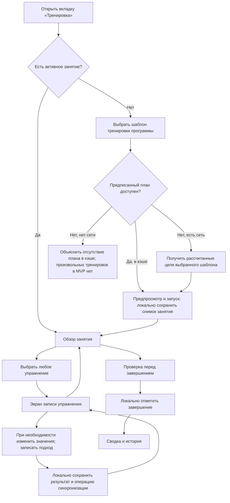

# Мобильная PWA — спецификация UX тренировок (предложение v0.2)

**Статус:** рабочий черновик UX. Принято: начало тренировки по шаблону (ADR-0005), отдельный экран записи упражнения (ADR-0006), предзаполнение плановыми значениями и индикаторы сравнения планового/фактического объёма подхода (ADR-0008, заменяет ADR-0007). Остальные взаимодействия — предложения.
**Обновлено:** 2026-10-18

Снимки плана, состояния занятия/доставки, повторный вход и кэш конкретизированы в [проекте P02.3](workout-sync-design.md). Контракты этого проекта приняты в ADR-0015; работа локального клиента не означает, что синхронизация уже реализована.

Минимальные графики, сопоставимость показателей и кэш отчётов определены в [P02.4.1](progression-and-analytics-design.md) и приняты в ADR-0016. Их реализация ещё предстоит; прежние иллюстративные графики прототипа не являются проверкой формул.

Документ расширяет предыдущий черновик мобильного приложения. Принятые требования к платформе и работе без сети записаны в [ADR-0002](adr/0002-local-first-pwa.md). Подробности взаимодействия ниже остаются предложениями до обсуждения и одобрения.

В P02.1 подготовлен отдельный [черновик границ MVP и сценария](mvp-scope.md): он отделяет принятые ограничения от конкретных продуктовых выборов, задаёт действия экранов и критерии проверки. До его одобрения не считай кандидатов ниже утверждённым объёмом; примеры прототипа не закрывают открытые вопросы.

После подтверждения границ пользователь запросил реализацию: первый [локальный клиент P03.1](../web/README.md) сохраняет записи в браузере и открывается без сети. Он использует тестовую программу, не имеет входа/серверной синхронизации и не подтверждает все кандидатные возможности этой спецификации.

## Цели и ограничения

- Удобство использования одной рукой во время тренировки, минимум ввода текста или его отсутствие, без голосового взаимодействия.
- Запись обычного подхода **одним нажатием**, если рекомендуемые вес/повторения совпали с выполненными.
- Возможность менять порядок упражнений, нагрузку и объём **в рамках занятия** без автоматического изменения постоянной программы.
- Работа при отсутствии сети на iOS и Android.
- Поддержка личных аккаунтов и закрытых локальных данных, разделённых по пользователям.
- Просмотр прогресса упражнений и графиков без обязательного визуального редактора программ.
- Сервер рассчитывает предписанные нагрузки. Клиент записывает фактические результаты, а не принимает решения о прогрессии.
- **Принятое ограничение MVP:** новые тренировки запускаются только из шаблона, принадлежащего программе пользователя. Без создания произвольных/пустых тренировок. Пользователь выбирает шаблон; порядок не навязывается.
- **Принятая навигация тренировки:** компактный список (обычно 4–5 упражнений, без жёсткого лимита) ведёт на отдельный экран записи/исправления весов, повторений и подходов.
- **Уточнение P02.1:** в MVP только вес в кг, подходы и повторения; отдельные режимы собственного веса, помощи тренажёра, времени/расстояния отложены.
- **Принятые значения по умолчанию и визуальное сравнение:** каждый новый рабочий подход предзаполняется **плановыми**, а не последними фактическими значениями. Индикатор подхода сравнивает **фактический объём (вес × повторения)** с **плановым объёмом (вес × повторения)**, показывая недобор и превышение. Отдельно отображается фактическое/плановое число рабочих подходов.

## Интерактивный UX-прототип

Самостоятельный браузерный прототип для проверки доступен в [`prototype/index.html`](../prototype/index.html). В нём работает навигация между выбором тренировки, предпросмотром, активным занятием, подробным экраном записи, завершением, историей, статистикой, настройками и имитацией отсутствия сети/переключения аккаунтов. Прототип намеренно использует вымышленные данные и состояние только в памяти; это **не** настоящая PWA, он не реализует IndexedDB/серверную синхронизацию. Его взаимодействия — кандидаты для обсуждения UX, а не утверждённые контракты.

## Навигация (предложение)

Три основные вкладки:

| Вкладка | Основное содержимое | Доступ во время активного занятия |
| --- | --- | --- |
| **Тренировка** | предпросмотр следующего занятия или обзор активного; экран записи отдельного упражнения | стартовый экран по умолчанию; продолжение всегда видно |
| **История** | занятия, подробности, исправления | да |
| **Статистика** | графики упражнений и сводки тренировок | да |

Аккаунт/настройки и диагностику синхронизации можно разместить за пунктом профиля/настроек без четвёртой основной вкладки. При уходе из активного занятия нужен видимый способ вернуться к тренировке.

## Основные экраны

### A. Главный экран / выбор шаблона / предпросмотр

Когда активного занятия нет:

- Показать **доступные шаблоны тренировок текущей программы пользователя**. Примеры названий: «День ног», «Спина и плечи», «Грудь и плечи», «Верх тела»; это **не жёстко заданные общие категории**.
- Пользователь может выбрать **любой** доступный шаблон для сегодняшней тренировки; не навязывать строгое чередование A→B→C и не перепланировать всю программу незаметно.
- При наличии политики расписания можно выделять следующий шаблон, предложенный сервером; пользователь может выбрать другой.
- После выбора показать список упражнений шаблона, целевые подходы/повторения/нагрузки и недавние сопоставимые результаты, затем кнопку **Начать тренировку**.
- Предписанные веса/повторения каждого шаблона рассчитывает серверная логика прогрессии, а не телефон.
- Без сети показывать локально кэшированные шаблоны с доступными кэшированными снимками предписанных целей. **Пригодный кэшированный план** можно запустить без сети; если нужного плана нет в кэше, объяснить недоступность запуска, а не придумывать рассчитанные нагрузки.
- Политика кэширования/актуальности и поведение при изменении агентом кэшированного шаблона на сервере остаются **открытыми подробностями проекта**.
- Новая пустая/произвольная тренировка **не входит в MVP**; новые постоянные шаблоны добавляет агент через API/MCP.

При активном занятии показывать **Продолжить тренировку**, а не незаметно создавать ещё одно.

### B. Обзор активного занятия (список; принятая навигация)

- Обычная тренировка короткая (около **4–5 упражнений**); показывать весь список в компактном обзоре без числового ограничения шаблона.
- Заголовок: название тренировки, длительность/время начала, компактный индикатор синхронизации, действие **Завершить**.
- Строки упражнений: название/оборудование, предписанные подходы × повторения и нагрузка, число выполненных подходов, результат прошлого занятия.
- **Нажатие строки упражнения открывает отдельный экран записи.** В MVP не размещать основные элементы записи подхода и редактирования веса/повторений в каждой строке обзора.
- Порядок упражнений гибкий; всегда можно вернуться к списку и открыть другое упражнение.
- В MVP используй только упражнения выбранного шаблона: пользователь в P02.1 отложил разовые замены и добавление. Открывать позиции можно в любом порядке; пропуск с необязательной причиной и отдельное изменение порядка отображения остаются предлагаемыми действиями. Они не изменяют постоянную программу.
- Выполненные упражнения остаются доступны для просмотра/исправления.
- Не фиксировать постоянные изменения программы с этого экрана незаметно.

### C. Запись упражнения (отдельный экран; принятый объём)

Подробный экран упражнения — **основное место записи и исправления фактических весов, повторений и подходов**, с крупными областями нажатия.

Предлагаемая структура сверху вниз:

1. Название упражнения и возврат к компактному списку тренировки. Предписанные цели, предыдущий сопоставимый результат и компактное состояние синхронизации.
2. Редактор текущего подхода: **вес**, **повторения**, кнопки +/- (необязательный числовой ввод) и заметная кнопка **Записать подход**.
3. Уже записанные фактические подходы: номер, вес, повторения, рабочий/разминочный тип; нажатие строки для **редактирования/исправления** или отмены/удаления. Исправления не должны незаметно исчезать из истории аудита/синхронизации.
4. **Изменение количества подходов:** пользователь может выполнить меньше или больше подходов, чем предписано. Фактическое число определяется записанными подходами; нужен явный способ добавить подход, удалить ошибочный и закончить упражнение раньше.
5. Возврат к обзору; переключение упражнений сохраняет результаты и незавершённый ввод.

**План и факт:** плановое количество подходов (например, 3) остаётся видимым и неизменным в снимке плана; выполненных/фактических подходов может быть 2, 3, 4 и т. д. Четвёртый выполненный подход — дополнительный **результат занятия**, а не незаметное постоянное изменение шаблона. Точный интерфейс изменения *намеченного* числа подходов до записи и простого добавления/удаления *фактических* подходов остаётся открытым.

**Принятое правило предзаполнения:** каждый новый рабочий подход начинается с **плановых веса и повторений** независимо от результата предыдущего. Если план задаёт разные цели по номерам подходов, использовать собственные цели текущего планового подхода. При записи рабочего подхода сверх планового количества использовать цель последнего планового рабочего подхода и явно помечать подход как дополнительный. Ввод остаётся редактируемым. Исправление старого результата не меняет задним числом значения по умолчанию другого планового подхода.

**Точные опорные значения:** предписание диапазона повторений (например, 8–12) также требует **явного рекомендуемого числа повторений от сервера** для ввода и сравнения, например 10, чтобы телефон не придумывал цель. Сам диапазон остаётся видимым отдельно. Схему целевых значений для каждого подхода предстоит спроектировать.

**Принятый индикатор объёма (окончательный вид остаётся открытым):**

- Для каждого записанного рабочего подхода рассчитывать **объём/тоннаж подхода**: `actual_weight_kg × actual_reps`. Сравнивать с `planned_weight_kg × suggested_reps` из зафиксированного снимка плана этого подхода. Отображаемое соотношение — `actual_volume / planned_volume`, если плановый объём положителен.
- **Ниже плана:** заполнение заканчивается до видимой отметки 100%. Пример: `60 кг × 8 = 480 кг` относительно `60 кг × 10 = 600 кг` → **80%**.
- **По плану:** заполнение достигает отметки 100%. Пример: `60 кг × 10 = 600 кг` → **100%**.
- **Выше плана:** заполнение продолжается за видимую отметку 100% с ограниченным визуальным превышением, но **неограниченным числовым процентом**. Пример: `70 кг × 9 = 630 кг` → **105%**.
- **Видимый компромисс:** `65 кг × 9 = 585 кг` → **97,5%**, а не просто «9 из 10 повторений» (90%). Всегда показывать фактические вес и повторения; если что-либо отличается от плана, разницу можно прочитать без второго графика.
- Показывать **фактический и плановый объёмы числами** (например, `585 / 600 кг · 97,5%`) и ясно подписанную отметку 100%. Использовать отдельный **индикатор числа рабочих подходов** (`2 / 3`, `4 / 3 · +1 дополнительный`), чтобы были видны лишние и недостающие подходы. Заполнение счётчика подходов не является индикатором объёма подхода.
- **Нет корректного положительного планового объёма:** не делить на ноль и не показывать вымышленный индикатор 0%/100%. Собственный вес, помощь, расстояние/время отложены за рамки MVP по решению P02.1; не кодировать их фиктивным весом в кг.
- **Разминка и незаписанные подходы:** разминка не засчитывается в выполненные плановые рабочие подходы; незаписанные плановые подходы не превращаются в вымышленные результаты с нулевым объёмом.
- **Интерпретация:** объём здесь — сравнение записанных килограммов × повторений, **не механическая работа**, не универсальная мера силы и не автоматический критерий успешной прогрессии. Серверная прогрессия по-прежнему использует исходные подходы и явные правила.
- Не кодировать выполнение только цветом; показывать подписи, фактические/плановые числа и разницы объёма. Точная ширина превышения и решения по доступности остаются подробностями UX-проекта.

**Ещё не решено:** точные кнопки шага веса для упражнения/оборудования; необязательные RIR/RPE, отсчёт отдыха и полезность графика общего объёма упражнения. Ничто из этого не должно добавлять обязательные нажатия.

**Инвариант взаимодействия:** одно нажатие записывает обычный подход при достижении рекомендуемых значений, но сбой локального сохранения **не** является успешной записью. Считать подход записанным только после успешного локального сохранения.

**Важно:** успешное нажатие подтверждается только **после** надёжной фиксации подхода и операции синхронизации в локальном хранилище. Иначе показать ошибку и оставить ввод на экране для повтора.

### D. Завершение тренировки / проверка

- Сводка записанных упражнений/подходов с показом пропущенных или неполных плановых упражнений.
- Разрешить завершение при неполном плане и без сети; не требовать вымышленных результатов пропущенных подходов.
- Подтверждать значимое действие завершения; отличать отмену/прекращение от завершения.
- Сохранять завершённое состояние локально с ожидающей операцией синхронизации и сразу показывать локальную сводку завершения.
- Разрешить открывать завершённое занятие для последующих исправлений. Исправления должны сохраняться в серверном аудите.

### E. История

- Список занятий по датам со статусом: активное, завершённое, отменённое/прекращённое (набор статусов предстоит уточнить).
- Открытие занятия для сравнения снимка плана с фактическими подходами и невыполненным остатком; замены упражнений в MVP отложены.
- Исправление подхода с явным показом до/после; никогда не перезаписывать незаметно подход, изменённый удалённо.
- Локально несинхронизированные занятия видны в истории с индикатором синхронизации.

### F. Статистика

- Выбор упражнения и периода; графики рабочего веса, повторений, объёма и расчётного 1ПМ (явно обозначать как оценку).
- Обзор тренировок: частота, рабочие подходы и общий объём за период.
- Показывать единицы; избегать сравнения тренажёров/упражнений с неэквивалентной семантикой измерений.
- Кэшированные графики могут быть доступны без сети с отметкой времени обновления; достоверные расчёты остаются на сервере.
- Занятие, добавленное локально, но ещё не синхронизированное, не должно выглядеть уже включённым в серверные агрегаты. Либо показывать отдельно помеченный локальный предпросмотр, либо ждать серверного пересчёта.

## Основной сценарий взаимодействия

Схема Mermaid описывает сценарий UX, а не полный автомат состояний сервера.

## Разделение состояний (важно)

**Не** моделировать подключение к сети как состояние тренировки.

**Жизненный цикл тренировки (предложение):**
`preview -> active -> completed` (предпросмотр → активна → завершена), с явными альтернативами `cancelled/abandoned` (отменена/прекращена).
Сохранённый предпросмотр не обязательно является серверным занятием. Начатое занятие всегда имеет стабильный идентификатор, созданный клиентом, и зафиксированный снимок плана.

**Жизненный цикл синхронизации (независимый):**

| Состояние операции | Значение | Отображение в интерфейсе |
| --- | --- | --- |
| `queued` | сохранена локально, не подтверждена сервером | «Сохранено на устройстве · N в очереди» |
| `sending` | выполняется попытка доставки | ненавязчивый значок синхронизации |
| `acknowledged` | сервер подтвердил применение | «Синхронизировано» |
| `blocked` | авторизация/конфликт/валидация требуют внимания | видимое действие, данные никогда не отбрасываются |

Подключение и синхронизация могут меняться без изменения жизненного цикла тренировки. Завершённое локально сохранённое занятие остаётся завершённым для пользователя, пока доставка ожидает выполнения.

## Работа без сети и синхронизация

### Локальные данные (предложение)

- Доступные шаблоны последней известной опубликованной программы пользователя и заранее загруженные снимки рассчитанных целей для соответствующих шаблонов (точная политика загрузки открыта).
- Снимок активной тренировки и результаты, введённые пользователем.
- Очередь исходящих операций (добавление/исправление записей, завершение и пропуски) и состояние подтверждения.
- Небольшой кэш истории и необязательные кэшированные результаты графиков.
- Ключ разделения по аккаунтам и локальный идентификатор устройства.

Для каждой операции использовать стабильный идентификатор операции, идентификатор занятия в рамках пользователя, тип, данные, время создания и при необходимости поля версии/предусловий. Идентификаторы должны сохраняться при повторах и перезапусках приложения. Сервер определяет пользователя по аутентификации, **а не** по идентификатору пользователя в операции.

### Сохранение и отправка

1. Одна транзакция IndexedDB сохраняет результат и его исходящую операцию.
2. Интерфейс сразу обновляется после фиксации и показывает «сохранено локально» (не «синхронизировано»).
3. При наличии сети и работе на переднем плане пытаться доставить немедленно. Повторять при запуске/возобновлении и изменениях подключения.
4. Необязательно регистрировать браузерный Background Sync там, где он поддерживается, без зависимости от него.
5. Сервер устраняет дубли повторных операций и подтверждает точный идентификатор операции.
6. Хранить ожидающие операции до подтверждения; не отбрасывать конфликты незаметно.

Истёкшая авторизация **не** должна блокировать локальную запись в рамках уже установленной локальной учётной записи; синхронизация продолжается после безопасной повторной аутентификации. Переключение аккаунта/выход с ожидающими данными должны явно защищать несинхронизированные записи.

### Изменение программы во время отсутствия сети

- Начало тренировки фиксирует снимок доступного плана и метаданных рекомендации.
- Последующая версия программы от агента не переписывает цели активного занятия и фактически записанные подходы.
- При восстановлении сети клиент может получить новую программу для **следующей** тренировки.
- Несовместимое или устаревшее состояние программы требует явного, видимого пользователю разрешения; не угадывать новую прогрессию на телефоне.

### Несколько устройств

У пользователя может быть несколько устройств, но одно занятие/подход не должно незаметно перезаписываться по принципу последней записи. Конкурентные изменения должны давать обнаруживаемый конфликт с безопасным интерфейсом восстановления; подробные правила слияния остаются открытыми.

### Сценарии сбоев

- **Сбой транзакции локального хранилища:** не утверждать, что подход сохранён; оставить ввод и предложить повтор.
- **Приложение принудительно закрыто без сети:** восстановить сохранённое локальное активное занятие и очередь при открытии.
- **Сервер получил операцию, но ответ потерян:** повторить с тем же идентификатором операции; сервер возвращает прежнее подтверждение.
- **Завершение без сети:** отметить завершение локально и поставить его в очередь; история явно показывает ожидание синхронизации.
- **Выход с операциями в очереди:** нужна политика, исключающая незаметную потерю или случайную отправку в чужой аккаунт.
- **Данные браузера очищены:** несинхронизированная работа может оказаться невосстановимой; показывать это ограничение там, где уместно.

## Проверка качества UX (кандидаты в приёмочные тесты)

1. При заранее кэшированном плане занятия и без сети начать тренировку, записать три подхода и завершить; локальный результат сохраняется после перезапуска PWA.
2. Обычный подход с совпадающими значениями записывается одним нажатием; другой вес/повторения вводятся крупными элементами управления. После записи `60 кг × 8` при плане `60 кг × 10` следующий подход всё равно получает плановые значения, а не `60 × 8`.
3. Индикатор сравнивает записанные **вес × повторения** с плановыми: `60×8 / 60×10 = 80%`, `60×10 / 60×10 = 100%`, `65×9 / 60×10 = 97,5%` и `70×9 / 60×10 = 105%` (видимое превышение). Вес и повторения также отображаются.
4. Счётчик подходов различает `2/3` и `4/3` без изменения плана. Переключение упражнений во время тренировки сохраняет все записанные результаты.
5. Локально завершённая несинхронизированная тренировка видна в истории с точным состоянием.
6. После восстановления сети повторы синхронизации не дублируют подходы, даже если прежнее подтверждение потерялось.
7. Изменение программы агентом не меняет снимок активной тренировки.
8. iOS работает корректно, даже если фоновая синхронизация ни разу не срабатывает; возобновление приложения повторяет ожидающие операции.
9. Истёкшая авторизация и конфликтующие удалённые правки не вызывают незаметной потери ожидающих записей.
10. Ни один пользователь не видит чужие локальные или серверные данные при обычном переключении аккаунта.
11. Статистика обозначает устаревший кэш и не объединяет незаметно несинхронизированные и серверные данные.

## Открытые вопросы проекта для обсуждения

1. **Выбор шаблона без сети:** какие шаблоны и снимки рассчитанных сервером целей загружать заранее и как разрешать устаревание кэша после изменения агентом? Создание пустой/произвольной тренировки не входит в MVP.
2. **Подробности упражнения:** отдельный экран принят; решить, как менять намеченное количество подходов и записывать дополнительные/пропущенные фактические подходы, как исправлять/удалять записанный подход.
3. **Вид индикатора объёма:** окончательный масштаб превышения, необязательный суммарный объём упражнения и рекомендуемые сервером повторения внутри диапазона. Плановое предзаполнение и индикаторы объёма каждого подхода приняты (ADR-0008); в MVP только вес в кг/подходы/повторения (P02.1).
4. **Завершение:** требования к подтверждению пропущенных плановых подходов и необязательная субъективная сводка.
5. **Синхронизация без сети и конфликты:** точный порядок операций, интерфейс разрешения конфликтов и обработка переключения аккаунтов.
6. **Объём:** замены и добавление упражнений отложены пользователем в P02.1; необязательные RIR/RPE и таймер отдыха пока остаются предложениями.
7. **Статистика:** минимальные графики и влияние локальных подходов в очереди на предварительные графики.

**Принято:** запуск по шаблону (ADR-0005); короткий обзорный список и отдельный экран записи (ADR-0006); каждый подход получает плановые значения по умолчанию, а его индикатор измеряет **кг × повторения** относительно планового объёма, показывая недобор и превышение (ADR-0008 заменяет ADR-0007). Названия мышечных групп и 4–5 упражнений — примеры, а не обязательные ограничения.

Остальные вопросы нужно решить до того, как подробные макеты, диаграммы состояний и контракты клиента/API будут считаться утверждёнными.
