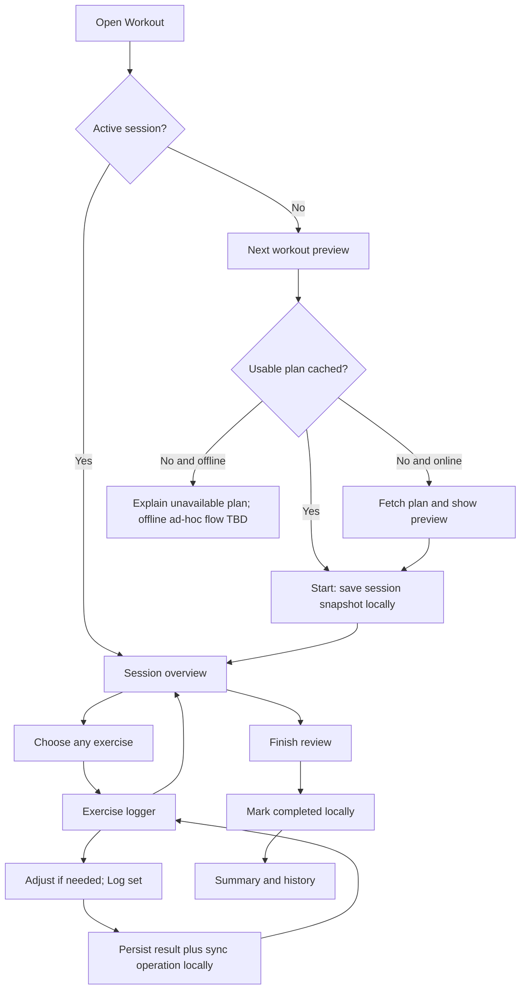

# Mobile PWA — workout UX specification (proposed v0.2)

**Status:** Design proposal for review; not an approved UX contract.
**Updated:** 2026-10-18

This document expands the earlier mobile app draft. Accepted platform and offline requirements are recorded in [ADR-0002](adr/0002-local-first-pwa.md). Interaction details below are proposals until discussed and approved.

## Goals and constraints

- Be usable with one hand, during a workout, with little or no typing and no voice interaction.
- Record a normal set with **one tap** if the suggested weight/reps match what was performed.
- Permit changing exercise order, load and volume **within a session**, without automatically modifying the persistent program.
- Work during network outages on both iOS and Android.
- Support personal accounts and private, user-scoped local data.
- Allow viewing exercise progress and graphs, but do not require a visual program editor.
- The backend calculates prescribed loads. The client records actual results, not progression decisions.

## Navigation (proposal)

Three primary tabs:

| Tab | Main content | Access during an active session |
| --- | --- | --- |
| **Workout** | next session preview or active session overview; individual exercise logger | default landing screen; resume always visible |
| **History** | sessions, details, corrections | yes |
| **Statistics** | exercise charts and training summaries | yes |

Account/settings and synchronization diagnostics can live behind a profile/settings entry, not a fourth primary tab. A visible return-to-workout affordance is needed when navigating away mid-session.

## Primary screens

### A. Workout home / preview

When there is no active session:

- Show the suggested next workout (e.g. “Workout A”), number of exercises and a **Start workout** action.
- Show prescribed sets, rep ranges and load preview, plus the most recent result where cached.
- Warn only when the displayed plan is stale or unavailable; being offline does not block starting a **cached, ready** plan.
- If there is no program or no usable cached plan, show a clear, actionable state; ad-hoc offline session creation is an **open decision**.

When a session is active: show **Resume workout** instead of silently creating another session.

### B. Active session overview (list-first)

- Header: workout name, duration/time started, compact sync indicator, **Finish** action.
- Exercise rows: name/equipment, prescribed sets × reps and load, count of completed sets, previous session result.
- Selecting any row opens that exercise logger; no enforced sequence.
- Session-only actions: reorder exercises; skip with optional reason; replace exercise; add an exercise (candidate for MVP).
- Completed exercises remain accessible for inspection/correction.
- Do not silently commit permanent program changes from this screen.

### C. Exercise logger (focus view)

Prioritize the current set and large touch targets:

1. Exercise name, target sets/reps/weight and recent comparable result.
2. Clearly labeled **weight** and **reps** values, with +/- buttons (and optional numeric editing).
3. Prominent **Log set** control.
4. Logged sets with set number, weight, reps, type (warm-up/working) and edit/undo affordance.
5. Back to overview; freely switch exercises without losing draft input.

Suggested defaults (to test): first set inherits prescribed load/reps; subsequent sets inherit the just-recorded actual load/reps. Adjustment increments depend on exercise/equipment and may need configuration; do not assume every exercise uses +2.5 kg. Optional RIR/RPE should not add mandatory taps.

**Important:** a successful button press is acknowledged only **after** the set and sync operation are durably committed to local storage. Otherwise show an error and leave the entry on screen for retry.

### D. Finish workout / review

- Summarize logged exercises/sets and show skipped or incomplete planned exercises.
- Permit finishing despite incomplete plan and without connectivity; do not force invented results for missed sets.
- Confirm a meaningful completion action; make cancellation/abandonment distinct from completion.
- Save the completed state locally with a pending sync operation, and show a local completion summary immediately.
- Allow opening the finished session to correct entries later. Corrections must remain auditable server-side.

### E. History

- List sessions by date with status: active, completed, cancelled/abandoned (status taxonomy to finalize).
- Open a session to compare snapshot plan vs actual sets, including replacements/skips.
- Correct a set with a clear before/after display; never silently overwrite a remotely edited set.
- Locally unsynced sessions are visible in history with a sync indicator.

### F. Statistics

- Exercise selector and time window; graph working weight, reps, volume and estimated 1RM (explicitly an estimate).
- Training overview: frequency, working sets and total volume across a period.
- Show units; avoid comparing machines/exercises with non-equivalent measurement semantics.
- Cached graphs may be visible offline, labeled with “updated at” time; authoritative computations stay on backend.
- A session added locally but not yet synced should not be misrepresented as already included in server-derived aggregates. Either display a separately labeled local preview or await server recomputation.

## Primary interaction flow

The mermaid flow is a UX flow, not the entire backend status machine.

## State separation (important)

Do **not** model connectivity as a workout state.

**Workout lifecycle (proposed):**
`preview -> active -> completed`, with explicit `cancelled/abandoned` alternatives.
A persisted preview is not necessarily a backend session. A started session always has a stable client-generated ID and a frozen plan snapshot.

**Sync lifecycle (independent):**

| Operation state | Meaning | UI representation |
| --- | --- | --- |
| `queued` | locally saved, not acknowledged by server | “Saved on device · N pending” |
| `sending` | currently attempting delivery | unobtrusive syncing icon |
| `acknowledged` | server confirmed application | “Synced” |
| `blocked` | authorization/conflict/validation requires attention | visible action, never discard data |

Connectivity and sync may change without changing the workout lifecycle. A completed, locally saved session is still completed from the user's perspective while delivery remains pending.

## Offline and synchronization behavior

### Local data (proposed)

- Last known published program snapshot and prefetched workout target(s).
- Active workout snapshot and user-entered results.
- Outbound operation queue (append/write corrections, completion and skips) plus acknowledgment state.
- Small history cache and optionally cached chart results.
- Account partition key and local device identity.

For each operation, use a stable operation ID, user-scoped session ID, kind, payload, creation time and version/precondition fields where needed. IDs must survive retries and app restarts. Server establishes identity from auth, **not** a user ID supplied in the operation.

### Saving and sending

1. One IndexedDB transaction stores both the result and its outbound operation.
2. UI immediately updates after commit and indicates “saved locally” (not “synced”).
3. While online and foregrounded, try immediate delivery. Retry on startup/resume and connectivity changes.
4. Optionally register browser Background Sync where supported, without relying on it.
5. Server deduplicates repeated operations and acknowledges the exact operation ID.
6. Keep pending operations until acknowledged; do not silently drop conflicts.

Expired authorization should **not** block local logging under an already established local identity; syncing resumes after a safe reauthentication flow. Account switching/logging out with pending data must explicitly protect unsynced records.

### Program changes while offline

- Starting a workout freezes a snapshot of the available plan and recommendation metadata.
- An agent's later program revision does not rewrite active session targets or actual logged sets.
- On reconnection the client can fetch the new program for the **next** workout.
- Incompatible or stale program state needs an explicit user-visible resolution; do not guess a new progression on the phone.

### Multiple devices

A user may have several devices but the same session/set must not be silently overwritten by last-write-wins. Concurrent edits should generate a detectable conflict with a safe recovery UI; detailed merge rules remain open.

### Failure scenarios

- **Local storage transaction fails:** do not claim the set was saved; retain input and offer retry.
- **App is killed while offline:** re-open from durable local active session and queue.
- **Server received an operation but response was lost:** retry with identical operation ID; server returns prior acknowledgment.
- **Finish while offline:** mark complete locally and queue completion; history clearly shows pending sync.
- **Logout with queued operations:** require a policy preventing silent loss or accidental cross-account upload.
- **Browser data cleared:** unsynced work may be unrecoverable; display this limitation where relevant.

## UX quality checklist (candidate acceptance tests)

1. With an already cached session plan and no network, start a workout, log three sets and finish; the locally saved result survives a PWA restart.
2. A normal matching set takes one tap; a different weight/reps can be entered with large controls.
3. Switching exercises mid-workout preserves any logged results.
4. A locally completed, unsynced workout is visible in history with an accurate status.
5. After reconnecting, sync retries do not duplicate any set even if a prior acknowledgment was lost.
6. Changing a program from the agent does not alter an in-progress workout snapshot.
7. iOS works correctly when background sync never fires; resuming the app retries pending operations.
8. Expired auth and conflicting remote edits do not cause silent loss of pending records.
9. No user can see another user's local or server data through a normal account switch.
10. Statistics identify stale cache and do not silently combine unsynced and server data.

## Open design questions for review

1. **Starting offline:** must a session be started only from a cached, precomputed plan, or should an empty/ad-hoc workout be possible?
2. **Exercise entry:** one-tap only inside the focused logger, or also a quick-log control in each overview row?
3. **Prefill for the next set:** planned target vs last actual (possibly separately for weight and repetitions)?
4. **Finish behavior:** confirmation requirements for missed planned sets and optional subjective summary.
5. **Offline sync and conflicts:** exact operation ordering, conflict resolution UI and account-switch handling.
6. **Scope:** whether replacement, extra exercises, RIR and rest timer belong in initial MVP.
7. **Statistics:** minimal graphs and whether locally queued sets influence preview charts.

These choices should be resolved before detailed wireframes, state charts and client/API contracts are considered approved.
