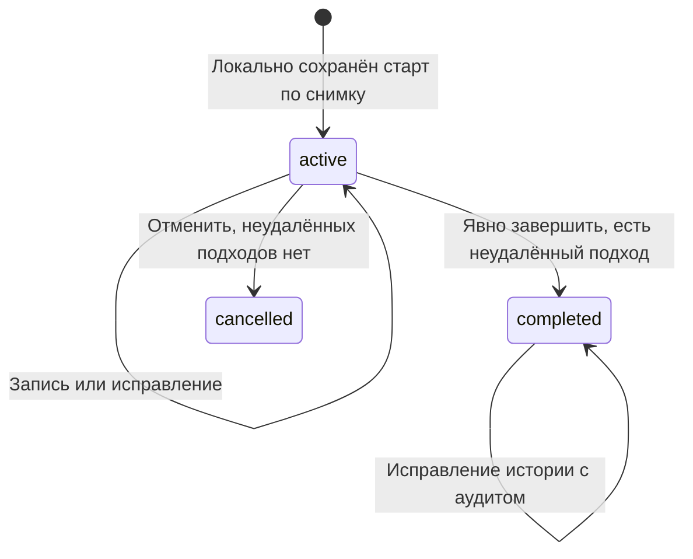

# Снимки тренировок, кэш и синхронизация — P02.3

Обновлено: 2026-10-26. **Проект P02.3 принят пользователем командой «Завершаем этап» 2026-10-26; протокол ещё не реализован.** Принятая основа — ADR-0002–0005, ADR-0008 и [ADR-0014](adr/0014-user-sessions-and-agent-authorization.md). Решения этого документа зафиксированы в принятом [ADR-0015](adr/0015-workout-snapshots-and-sync.md). Выбор версии при конфликте дополнительно подтверждён отдельным ответом пользователя.

Здесь определяем данные занятия и доставку фактов. Формулы прогрессии, точные схемы REST/MCP и численные ограничения размера запросов — P02.4. Обмен с YDB/SQLAlchemy проверяется в P03.2/P07. Текущий [локальный клиент](../web/README.md) сохраняет очередь, но не реализует описанный серверный обмен.

## 1. Данные и версии

| Объект | Идентификатор/версия | Правило |
| --- | --- | --- |
| Опубликованная программа | `program_id`, `program_version_id` | Версия неизменяема; новая публикация не меняет уже выданные снимки |
| Серверный план шаблона | `plan_snapshot_id`, `snapshot_schema_version` | Принадлежит пользователю; содержит конкретные цели и основание расчёта |
| Занятие | `workout_id`, `server_revision` | ID создаётся устройством до первой записи; ревизия повышается сервером при каждом принятом изменении |
| Упражнение занятия | `session_exercise_id` | Ссылка на конкретное вхождение упражнения в снимке, не только на общий `exercise_id` |
| Результат подхода | `set_id` | Стабильный ID; исправления сохраняют его, удаление оставляет отметку и аудит |
| Операция | `operation_id`, `schema_version` | ID и содержание фиксируются при локальном сохранении; сетевой повтор не создаёт новый ID |
| Изменение пользователя | `change_seq` | Серверная последовательность для получения изменений; часы устройства её не заменяют |

Для новых `workout_id`, `set_id`, `operation_id`, `device_id` — случайные UUID. Сервер устанавливает владельца из аутентифицированной сессии. Ключи хранения включают владельца; знание ID не даёт доступа. `device_id` служит диагностике, а не аутентификации.

Разделяй `local_revision` для конкурентных вкладок, `server_revision` занятия, версию программы и версию схемы протокола. Они не являются одним счётчиком. Начальная серверная ревизия после принятия создания занятия — 1; отсутствие занятия обозначается предусловием 0.

### Измерения

В MVP: в интерфейсе вес в кг, в протоколе/хранилище `weight_g` — целое число граммов. Начальные технические границы: 0–2 000 000 г и `reps` 1–1 000, только целые; ввод кг допускает до трёх знаков после запятой. Это ограничения формата, не рекомендации по нагрузке. Преобразовывай десятичный ввод без скрытого округления; значения вне формата отклоняй с сохранением ввода.

Шаг кнопок веса определяется снимком упражнения; он не требует округлять исторический факт до ближайшего доступного шага. Соглашение о весе (`weight_convention`, например общий вес внешнего отягощения) сохраняется в снимке. Разные соглашения/оборудование не объединяются в одну сопоставимую серию автоматически. RIR/RPE, время, расстояние, собственный вес и помощь не входят в этот контракт MVP.

## 2. Неизменяемый серверный план

Сервер заранее выдаёт планы **всех шаблонов текущей опубликованной программы**, пригодные для начала без сети. План содержит:

- Владельца, ID/версию программы и шаблона, `plan_snapshot_id`, версию схемы, время расчёта.
- Упорядоченные вхождения упражнений, их названия, оборудование, соглашение о весе и шаг кнопок.
- Стабильный ID каждой плановой позиции подхода, конкретные `weight_g` и `suggested_reps`; диапазон повторений отдельно, если он есть.
- Версию/параметры правила, ревизию исходной истории и версию расчётчика: достаточно для объяснения серверного назначения. Состав точных входов расчёта — P02.4.

Публикация программы и изменение учитываемой истории делают текущий набор планов устаревшим. Новый набор готовит сервер. Не заменяй его клиентским расчётом прогрессии; пока свежего набора нет, доступен прежний с предупреждением. При успешном локальном старте занятие закрепляет копию выбранного плана и его ID, а не изменяемый указатель «текущий план».

**Политика устаревания:** разрешать старт с последним сохранённым серверным планом даже после новой публикации. Показывать версию и дату, а при известном обновлении/старом основании — предупреждение. Дополнительно предупреждать после 7 дней без обновления; этот порог не запрещает запись. Без сохранённого плана нет старта нового занятия без сети, но уже начатое можно продолжить.

При доставке сервер находит собственный выданный снимок и проверяет владельца/состав. Присланная копия не становится источником серверных целей. Старый подлинный снимок принимается и после изменения программы; это осознанно использованный прежний план. Нельзя молча подменить его новым. Один план допускает несколько занятий: это не одноразовый билет на единственную тренировку и не прогноз следующих ступеней прогрессии.

Выданные планы, на которые могут сослаться отложенные старты, сохраняются сервером на срок жизни аккаунта до отдельной политики удаления. Срок хранения пакетов PWA 90 дней из ADR-0013 не является TTL планов/очереди. Если ссылка не найдена или чужая, сервер не придумывает план; возвращает явную ошибку и оставляет локальные факты для разбора.

## 3. Плановые и фактические подходы

| Вид результата | Связь с планом | Сравнение |
| --- | --- | --- |
| Рабочий плановый | `planned_target_id` конкретной свободной позиции своего упражнения | Её неизменные вес/повторения из снимка |
| Рабочий дополнительный | `planned_target_id = null`, `comparison_target_id` последней плановой позиции | Цель последнего планового подхода; результат явно дополнительный |
| Разминочный | Обе ссылки `null` | Нет рабочего процента или зачёта плановой позиции |

Новый рабочий подход занимает первую свободную плановую позицию, затем становится дополнительным. Клиент фиксирует выбранную связь в операции; сервер проверяет её по снимку и состоянию занятия. У одной позиции может быть не более одного неудалённого рабочего результата. При конфликте сервер не перепривязывает подход к другой цели незаметно.

Исправление веса/повторений не меняет связь с планом. Удаление освобождает позицию для новой записи, сохраняя прежнюю связь в аудите. Другие записанные подходы не перенумеровываются и не меняют цели: дополнительный не становится плановым после удаления раннего подхода. При изменении рабочего/разминочного типа явно записывается новая допустимая связь; предыдущий тип/связь остаются в событии исправления.

Для вычисления индикатора бери цель только из снимка; `comparison_target_id` у планового рабочего результата совпадает с `planned_target_id`. Не доверяй присланному клиентом проценту. Нулевой плановый вес допускается, но процент при нулевом объёме отсутствует по ADR-0008. Пропущенный подход — свободная плановая позиция, а не результат с нулём повторений.

## 4. Состояния занятия



Минимум MVP — `active`, `completed`, `cancelled`; будущие `planned`/`abandoned` из концептуального черновика в MVP не нужны. `completed` допускает неполный план и разминку без рабочих подходов. Исправление после завершения может добавить пропущенный факт, изменить или удалить запись, но не меняет исходный снимок и время завершения. Если удалён последний результат, занятие остаётся завершённым с исправленной пустой историей; оно не получает вымышленного зачёта прогрессии.

Отмена сохраняет запись занятия и аудит; `cancelled` терминален. «Пустое» означает отсутствие неудалённых результатов; прежние удалённые факты не исчезают из аудита. Закрытие браузера, потеря сети и долгая пауза не завершают занятие автоматически.

На одном устройстве нужно продолжать уже активное занятие, прежде чем начинать другое. Два устройства могут независимо начать разные занятия без сети: сервер сохраняет оба, показывает наличие нескольких активных и предлагает выбрать. Не вводи глобальную уникальность активного занятия, которая отвергнет уже записанные на другом устройстве результаты, и не объединяй занятия автоматически.

Состояние доставки независимо: завершённая тренировка может ещё ожидать отправки, а активная — быть полностью доставлена на текущий момент.

## 5. Локальная запись и очередь

Одна транзакция IndexedDB сохраняет изменение локальной проекции, неизменяемую операцию и новую `local_revision` владельца/занятия. Показывай успешную запись только после завершения транзакции. При ошибке места/доступа сохраняй ввод на экране, не добавляй успешную строку и не обещай сохранность после закрытия страницы.

Храни раздельно последнюю подтверждённую серверную версию и локальную проекцию с ожидающими правками. Полученный серверный снимок не перезаписывает локальную очередь. Несохранённый ввод не считается ни результатом, ни операцией. Сохранённую операцию не переписывай и не склеивай с последующей: редактирование/удаление записывается следующим действием со своим ID.

| Состояние операции | Значение | Действие |
| --- | --- | --- |
| `pending` | Надёжно сохранена локально | Отправить при выполненных зависимостях и проверенном владельце |
| `sending` | Выполняется попытка; исход ещё неизвестен | После перезапуска/обрыва повторить тот же ID и содержание |
| `acked` | Есть серверная квитанция об исполнении | Больше не отправлять; запись можно уплотнить после освобождения зависимостей |
| `blocked_auth` | Требуется вход или сервер запретил доступ | Сохранить и дождаться входа прежнего владельца/восстановления допуска |
| `conflict` | Предусловие не совпало; правка не применена | Показать версии и остановить зависимую цепочку |
| `rejected` | Постоянная ошибка данных/версии; не исполнена | Показать причину, сохранить намерение, исправлять новой операцией |
| `superseded` | Пользователь явно заменил/отклонил непринятую правку при разборе | Не выдавать за доставленную; сохранить связь с решением и новой операцией |

Одновременно отправляй не более одной операции занятия; разные занятия могут доставляться независимо. Вкладки координируют отправку через локальное хранилище и перечитывают `local_revision` перед изменением. Блокировка отправителя помогает избежать дублей запросов, но корректность обеспечивает серверная идемпотентность. Просроченная блокировка не разрешает менять ID операции.

Доставка запускается при открытом приложении, восстановлении связи, успешном входе и вручную. Background Sync — лишь дополнительная возможность. Сетевые/временные ошибки повторяются с ограниченной задержкой и разбросом; `Retry-After` учитывается. Точные пределы частоты — P02.4. Конфликты/ошибки данных не зацикливаются в автоматических повторах.

## 6. Конверт и зависимости

Конверт P02.3; окончательные JSON Schema и маршруты REST — P02.4. `expected_owner_id` — проверяемое ожидание клиента: он должен совпасть с личностью сервера, но никогда не назначает владельца.

```json
{
  "schema_version": 1,
  "operation_id": "10000000-0000-4000-8000-000000000001",
  "expected_owner_id": "user-a",
  "device_id": "20000000-0000-4000-8000-000000000001",
  "workout_id": "30000000-0000-4000-8000-000000000001",
  "precondition": { "server_revision": 0 },
  "client_occurred_at": "2026-10-26T15:00:00+03:00",
  "command": {
    "type": "start_workout",
    "plan_snapshot_id": "plan-a-v3"
  }
}
```

Следующая операция может быть создана без сети до получения серверной ревизии:

```json
{
  "schema_version": 1,
  "operation_id": "10000000-0000-4000-8000-000000000002",
  "expected_owner_id": "user-a",
  "device_id": "20000000-0000-4000-8000-000000000001",
  "workout_id": "30000000-0000-4000-8000-000000000001",
  "precondition": {
    "after_operation_id": "10000000-0000-4000-8000-000000000001"
  },
  "client_occurred_at": "2026-10-26T15:03:00+03:00",
  "command": {
    "type": "add_set",
    "session_exercise_id": "session-exercise-a",
    "set_id": "40000000-0000-4000-8000-000000000001",
    "kind": "working",
    "weight_g": 60000,
    "reps": 10,
    "planned_target_id": "target-a-1",
    "comparison_target_id": "target-a-1"
  }
}
```

Предусловие — ровно одно из `server_revision` и `after_operation_id`. Ссылка на предыдущую операцию означает ревизию, полученную **её успешным исполнением**, а не произвольную последнюю ревизию сервера. Предшественник должен принадлежать тому же владельцу/занятию. Неизвестная зависимость временно блокирует обработку без окончательной квитанции; отклонённая зависимость блокирует потомков до разбора. Цикл, ссылка на себя/другое занятие недопустимы.

Если старт дал ревизию 1, добавление из примера ожидает именно 1. Если другое устройство успело изменить занятие до его получения, произойдёт конфликт. После подтверждения цепочки новое независимое действие может указать известную `server_revision` числом. Локальный счётчик и `client_occurred_at` не подменяют это предусловие.

Временные метки устройства сохраняются как заявленное время тренировки; сервер отдельно пишет время получения/исполнения. Расхождение часов не определяет победителя конфликта и не сортирует зависимости. Повтор после тайм-аута не меняет время первоначального действия.

## 7. Серверная атомарность и квитанции

Для каждого изменения сервер выполняет проверки личности/допуска, Origin/CSRF для PWA и совпадения `expected_owner_id`; затем проверяет принадлежность занятия/снимка. Чужие ID не дают ни данных, ни квитанций другого аккаунта. Ограничение размера/частоты применяется до дорогой обработки.

Ключ квитанции — `(authenticated_user_id, operation_id)`, вне зависимости от устройства. Содержание операции сравнивается целиком после проверки версии/схемы; `device_id`, время, ожидание владельца, команда и предусловие входят в сравнение. Неизвестные поля отклоняются, а не молча исключаются. Перестановка JSON-ключей не меняет смысл. Канонизация: только определённые схемой поля, целые числа, одинаковое представление отсутствующих необязательных полей, ключи объектов в фиксированном порядке, порядок массивов сохранён. Точный алгоритм/контрольные примеры для хеша фиксируются в P02.4. Хеш — оптимизация сравнения, не доказательство прав.

В одной Serializable read-write транзакции YDB нужно:

1. Проверить текущую запись аккаунта и квитанцию. Отключение аккаунта и запись не должны пройти через разные непроверенные состояния.
2. Если квитанция существует с тем же содержанием — вернуть прежний результат, не исполняя команду повторно. Проверка квитанции предшествует проверке устаревшего предусловия.
3. Если ID использован с другим содержанием — `operation_id_reused`, без перезаписи прежней квитанции.
4. Разрешить зависимость и проверить точную ревизию/состояние, права и данные команды.
5. Атомарно записать новую версию занятия/фактов, событие аудита, квитанцию, следующий `change_seq` и признак устаревания производных расчётов.

Только после успешного commit возвращается исполнение. Коммит с потерянным ответом выясняется повтором того же ID/содержания. Технический повтор транзакции не создаёт новую операцию. Внешние HTTP-вызовы и публикация телеметрии не входят внутрь повторяемого тела транзакции.

YDB документирует Serializable и атомарный commit DML; это основание схемы, **не результат проверки нашего ORM**: [транзакции YDB](https://ydb.tech/docs/en/concepts/transactions). Поддержку нужных примитивов через выбранный драйвер/SQLAlchemy и гонки проверяем реальными интеграционными тестами; не подменяй их моками. DDL выполняется отдельными миграциями по ADR-0011/0013.

Пример неизменяемой квитанции принятого подхода из раздела 6:

```json
{
  "operation_id": "10000000-0000-4000-8000-000000000002",
  "workout_id": "30000000-0000-4000-8000-000000000001",
  "outcome": "applied",
  "server_revision": 2,
  "change_seq": 42,
  "accepted_at": "2026-10-26T12:03:01Z"
}
```

Старая квитанция на ревизию 2 остаётся верной, даже если сейчас занятие имеет ревизию 5. Клиент атомарно сохраняет квитанцию/подтверждённую базу и состояние очереди; не откатывает текущий экран старым ответом. Подтверждённая база не движется назад, оставшиеся локальные намерения не стираются. Если их нельзя применить поверх новой базы, сохраняются обе версии и показывается конфликт.

| Исход | Квитанция/повтор |
| --- | --- |
| Применено | Неизменяемая квитанция с ревизией и последовательностью |
| Ревизия не совпала | Окончательный `revision_conflict` для этого ID, без изменения занятия; для разрешения нужен новый ID |
| Валидная операция с постоянной ошибкой команды | Окончательная квитанция `rejected`; исправление — новая операция |
| Неизвестная/ещё не принятая зависимость | Временный `dependency_pending`; не помечать исполненной или окончательно отвергнутой |
| Нет входа/допуска, чужой объект, неверный CSRF | Отказ без исполнения и выдачи личной квитанции; восстановить доступ, не менять ID ради обхода |
| Некорректный конверт/неподдержанная версия | Явная ошибка без исполнения; сохранять данные для обновления/разбора |
| Сбой/тайм-аут/неопределённый commit | Нет подтверждения для клиента; повторить исходный ID/содержание |

Минимальные квитанции исполненных и окончательно отклонённых корректных операций сохраняются на срок жизни аккаунта; не удаляй их по короткому TTL. Иначе старый запрос после долгой работы без сети может выполниться заново. Уплотнять можно тело/индексы только с сохранением проверки содержания и прежнего результата. Удаление аккаунта/истории с таким журналом требует отдельной политики.

## 8. Конфликты и исправления

**Подтверждено пользователем 2026-10-26:** при одновременном исправлении одного подхода показывать текущую серверную версию и локальную правку с явным выбором. Последняя пришедшая запись не затирает чужое исправление автоматически.

Начальный вариант использует ревизию **всего занятия**: даже правки разных подходов могут потребовать сверки. Это проще проверить и соответствует локальному каркасу; цена — более частые конфликты двух устройств. Не объявляй автоматическое слияние независимых полей реализованным. Между разными занятиями такой блокировки нет.

Разбор: получить актуальное занятие, показать затронутые значения/тип/связь с планом и последующие локальные действия. Пользователь выбирает серверную версию либо применяет своё исправление к увиденной ревизии. Во втором случае создаётся новая операция с новым ID и актуальным предусловием; старая помечается заменённой только в одной транзакции с сохранением решения/новой цепочки. Повторный конкурентный конфликт снова требует сверки.

Зависимые операции нельзя просто выпустить после замены первого ID: их условия указывают на старую цепочку. Сохраняй весь суффикс, затем после решения сформируй новую цепочку явно подтверждённых намерений. Не отбрасывай последующие подходы/завершение и не применяй полную устаревшую копию занятия поверх сервера. Неопределённый исход сначала проверяется по исходному ID: его нельзя объявить конфликтом или заменить без выяснения исполнения.

Пример: оба устройства видят ревизию 4; A исправляет вес и получает 5, B исправляет повторения с ожиданием 4 и получает конфликт. Показать серверные и локальные значения. Решение применить правку B создаёт новый ID с ожиданием 5; при успехе возникает 6. Ревизия 4, исправление A и попытка/решение B прослеживаются в аудите.

Удаление — отметка, а не физическое уничтожение строки. Повтор той же операции удаления возвращает квитанцию; новая правка уже удалённого подхода требует разбора, а не воскрешает его. Исправления завершённых занятий создают новые ревизии и инвалидируют производные показатели; уже начатые планы и прошлые снимки остаются прежними. Правила перерасчёта последующих рекомендаций — P02.4/P09.

## 9. Получение изменений и кэш

Серверная последовательность изменений отдельна для пользователя; инкремент, событие и изменение данных фиксируются атомарно. В неё входят также публикации программы, выдача новых планов и отметки устаревания расчётов; точные типы событий — P02.4. Курсор непрозрачен и привязан к владельцу/версии протокола. Дельта возвращает упорядоченные события до зафиксированной верхней границы `H`; следующая страница продолжает ту же выборку. Новые записи после `H` попадут в следующий цикл. Событие содержит неизменяемую серверную ревизию изменённого занятия/ссылку на неё, а не перемещающийся указатель на текущую строку.

Полученную страницу и новый курсор сохраняй одной локальной транзакцией. После сбоя страницу можно повторить; меньшая/повторная ревизия не откатывает большую. Ревизии получают собственные `operation_id` для связи с очередью, но квитанция остаётся подтверждением конкретной операции. Незагруженная старая история может помечаться устаревшей и запрашиваться при открытии.

Первый вход/просроченный курсор требует bootstrap: текущая программа и планы, все активные занятия и последние 30 завершённых. Механизм согласованной пагинации — короткоживущий серверный манифест с границей `H` и ссылками на неизменяемые версии, собранный в согласованной транзакции. Страницы читают этот набор, а не меняющуюся выборку «последние сейчас». Срок манифеста — 15 минут; при истечении повторить bootstrap без удаления outbox. Реализация и объём транзакции проверяются на YDB в P03.2/P07.

Журнал дельты удерживаем 30 дней; просроченный курсор возвращает `cursor_expired`, затем bootstrap и сверка исходных операций. Квитанции от этого не истекают. Данные bootstrap сначала сохраняются как новая серверная база; ожидающие операции сохраняются отдельно и сверяются с ней. Это не команда очистить локальную историю/очередь или автоматически принять её старую версию за серверную.

Локальный минимум:

- Текущая программа и последние доступные серверные планы всех её шаблонов, с отметкой успешного сохранения.
- Все активные занятия; любые занятия/планы, связанные с ожидающими, ошибочными или конфликтными действиями.
- Последние 30 доставленных завершённых занятий; более старая история запрашивается постранично онлайн.
- Служебные квитанции/зависимости, курсор, локальный владелец и признак скрытого профиля; никаких токенов провайдера/MCP.

При недостатке места сначала допускается убрать только восстановимый серверный кэш вне закреплённых данных. Очередь, конфликты, неподтверждённые факты/снимки не удаляются для освобождения места. Если сохранение всё равно невозможно, показывай ошибку вместо успешной записи. Разрешённое сервером удаление не равно автоматическому стиранию несохранённых локальных намерений.

У браузера есть квоты и возможность удаления локальных данных; `navigator.storage.persist()` — попытка снизить риск, не обещание резервной копии: [MDN о хранении и вытеснении](https://developer.mozilla.org/en-US/docs/Web/API/Storage_API/Storage_quotas_and_eviction_criteria). Перед очисткой данных, переустановкой или сменой origin нужно предупредить о недоставленных записях. Экспорт/восстановление очереди пока не реализованы; если хранилище уже очищено, сервер не может восстановить факты, которых не получал.

## 10. Аккаунт, обновления и эксплуатация

Следуй принятому [потоку P02.2](authentication-design.md): вход тем же владельцем возобновляет доставку; другой аккаунт не получает старую очередь. Проверка `expected_owner_id` нужна и при серверном старте: иначе старый запрос мог бы создать занятие в новом аккаунте. Серверные проверки обязательны независимо от проверки клиента.

Перед выходом/переключением останови новые отправки, сохрани признак закрытого профиля и локальное поколение контекста. Поздний ответ не открывает прежний экран/профиль. Подтверждённую квитанцию можно сохранить только в исходный раздел при совпадении владельца/ID/содержания; она не запускает новые отправки. Уже начатый запрос может исполниться: после возврата прежнего владельца выясни исход повтором его ID.

Скрытый без сети профиль не открывается автоматически после перезапуска/восстановления связи. Истечение сессии при незакрытом профиле не мешает локальной записи. Факт выхода/блокировки не удаляет очередь. Локальный профиль не зашифрован; видимость интерфейса не обещает защиты от человека с доступом к данным браузера.

Service worker кэширует оболочку, не личные API/auth-ответы; личные данные — в аккаунтных разделах IndexedDB. Обновление не очищает базу и не принуждает к перезапуску во время занятия. Миграция локальной схемы должна быть атомарной/совместимой с сохранённой очередью; при блокирующей старой вкладке предложи её закрыть, не удаляй БД. `local-demo` автоматически в настоящий аккаунт не переносится.

Политика совместимости: первая серверная версия принимает schema 1 до явного заменяющего решения и миграции; возраст запроса сам по себе не делает его невалидным. Будущая несовместимость возвращает `upgrade_required` без исполнения/очистки очереди; нельзя молча отправить то же действие под новым ID/с другим содержанием. Конкретные JSON Schema и проверяемые преобразования — P02.4. Архивирование артефактов сборки не отменяет этот контракт.

Для пилота долгоживущие снимки, аудит и квитанции увеличивают хранение; нужно отслеживать объём относительно действующих лимитов YDB/бюджета. При заполнении БД/ошибке транзакции не подтверждай запись и не переключай источник истины на браузер. Данные удержания/удаления и масштабирование требуют отдельного решения перед ростом нагрузки. Телеметрия остаётся отдельной доставкой по возможности по ADR-0012, не частью надёжной очереди.

## 11. Будущая приёмка

Все пункты ниже — требования к тестам следующих этапов, **не выполненные проверки синхронизации**.

| ID | Сценарий | Ожидаемый результат |
| --- | --- | --- |
| SYNC-01 | Запись результата и сбой записи outbox | Обе записи откатились, ввод сохранён, успех не показан |
| SYNC-02 | Перезапуск без сети после сохранения | Снимок, факты и исходные ID операций восстановлены |
| SYNC-03 | Сервер исполнил запись, ответ потерян | Повтор вернул ту же квитанцию; один факт, одно событие, одна ревизия |
| SYNC-04 | Один ID одновременно отправлен из двух вкладок | Не более одного исполнения; один результат для одинакового содержания |
| SYNC-05 | Один ID с другим весом/временем/предусловием | Отказ без изменения прежней квитанции и фактов |
| SYNC-06 | Добавление пришло раньше старта | Временная зависимость; после старта повтор исходного ID допустим |
| SYNC-07 | Цикл/чужой или отклонённый предшественник | Нет исполнения/скрытой смены ревизии; зависимая очередь сохранена |
| SYNC-08 | Два устройства исправляют занятие с одной ревизии | Одно изменение принято, второе конфликтует; данные не затираются |
| SYNC-09 | Пользователь разбирает конфликт с зависимыми подходами/завершением | Новая явная цепочка, старые намерения не потеряны; новый конкурентный конфликт обнаружен |
| SYNC-10 | Удаление раннего подхода/смена рабочего типа | Стабильные ID, аудит и цели других подходов сохранены; нет двух результатов одной позиции |
| SYNC-11 | Дополнительный подход, разминка, нулевая цель | Верные связи/счётчики, нет вымышленного процента/нулевого факта |
| SYNC-12 | Новая программа/исправление истории после старта без сети | Использован исходный подлинный снимок, клиент не пересчитал прогрессию |
| SYNC-13 | Два устройства начали разные занятия без сети | Оба занятия/факты сохранены; нет автоматического объединения или отказа из-за другого активного |
| SYNC-14 | Неполное завершение/исправление завершённого/отмена пустого | Только допустимые переходы, аудит и отметка устаревших расчётов атомарны |
| SYNC-15 | Запись отключённого/другого владельца, включая старый старт | Серверный отказ без чужих данных; локальная очередь не перенесена |
| SYNC-16 | Выход/смена профиля во время запроса, поздний ответ | Нужный раздел и скрытие сохранены; новые отправки не запущены |
| SYNC-17 | Страница дельты получена, локальный commit не удался | Курсор не продвинут; повтор страницы безопасен |
| SYNC-18 | Изменения во время пагинации и просроченный курсор/манифест | Согласованная граница H, bootstrap без пропуска и очистки ожидающих записей |
| SYNC-19 | Чужой/подменённый план или курсор | Нет доступа и клиентского назначения серверных целей |
| SYNC-20 | Мало места/обновление PWA/блокирующая вкладка | Неподтверждённые данные не удалены, нет ложного успеха |
| SYNC-21 | Долгий перерыв, старая квитанция и старая schema 1 | Нет повторного исполнения по TTL; неподдержанный формат отказал явно без потери очереди |
| SYNC-22 | Две записи/сбой YDB между фактом, аудитом и квитанцией | Атомарное исполнение и повтор в реальной YDB/SQLAlchemy; мок не закрывает приёмку |
| SYNC-23 | Десятичный ввод кг и граничные/невалидные значения | Точное преобразование в граммы либо отказ без скрытого округления и потери ввода |

## Что проверить при реализации

Проект P02.3 принят: сохранённые серверные планы с предупреждением об устаревании, кэш 30 завершённых занятий, целые граммы, независимые старты устройств, ревизия занятия и явный выбор при конфликте. Перед серверной реализацией закрыть схемы/правила P02.4. Реальные транзакции, доставка, UI конфликтов и миграции проверяются на этапах реализации; решение не означает, что синхронизация уже работает.
